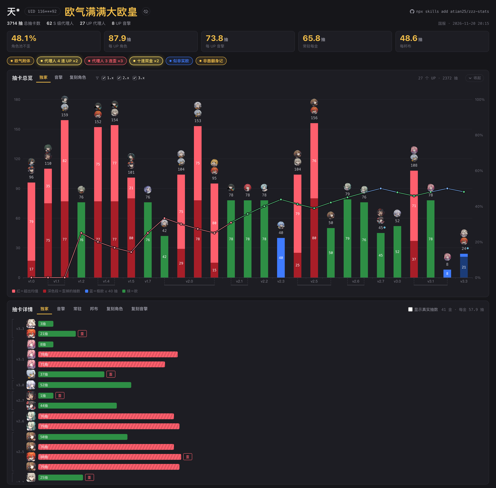

# zzz-stats

**《绝区零》抽卡记录分析与报表** · 一个 Agent Skill

```bash
npx skills add atian25/zzz-stats
```

<sub>[](https://skills.sh/atian25/zzz-stats) · 装好后对 agent 说「看看我的抽卡记录」即可</sub>

---

把《绝区零》官方「调频统计工具」的数据抓下来，生成一份**首屏一屏可读**的抽卡报表，主图下方附六频道抽卡详情。

这是一个 Agent Skill（`zzz-stats`）：扫码登录 → 抓官方接口 → 落本地 JSON → 一条命令出图。
**不绑定任何特定的浏览器工具**：会话里有自带浏览器（内建浏览器、moli、任何能执行 JS 的能力）就用它，
有 Playwright 就用 Playwright，都没有才由零依赖 CDP 自己起本机 Chrome。
核心只需要两个能力——**打开页面** 和 **在页面里执行 JS**。



## 能做什么

- **采集**：6 个频道（角色、音擎、常驻、邦布等）的总抽数、S 数、UP 数、当前垫抽，以及每一金的物品、稀有度、是否 UP、消耗抽数、时间戳、频道内序号。
- **报表**：`抽卡总览` 主图 = 每轮 UP 成本堆叠柱 + 累计不歪率折线，柱顶摞角色头像（歪出的在上）、十连双金标记、悬浮 tip、事件标签，可折叠主图方便截图；1440×900 / 1280×800 首屏无滚动。
- **抽卡详情**：第二屏按 6 个频道列出每一金的横条，条长 = 抽数、绿/红 = 欧非、红章 = 歪，可切换标签；左侧方括号按版本分组；整页铺开不内滚；勾「显示真实抽数」把歪的成本并进 UP。
- **口径可配**：称号分档、标签规则、配色、文案全在 `config/report.json`，改称号不用碰代码。
- **图标离线且内嵌**：角色、音擎、邦布图标随仓库带一份 64px 缓存，构建时 base64 内嵌进 HTML；产物是**真正自包含的单文件**，单独发给别人也能正常显示。缺图用占位图兜底，不裂图、不引 CDN。

## 装好之后

装到 Claude Code、Trae、Codex、Cursor、DeepSeek Harness 等任意支持 Agent Skill 的客户端，然后直接说：

> 看看我的绝区零抽卡记录

agent 会自己打开官方页面、把二维码交给你扫、抓完数据出报表。**你只需要扫码这一步。**

不想装也可以让 agent 直接跑：

> 安装 `https://github.com/atian25/zzz-stats` 这个 skill，并帮我运行

### 扫码有两种节奏

| 档位 | 适用 | 你的操作 |
|---|---|---|
| **A（默认）** | 会话支持后台任务 | 扫一次码，然后什么都不用做 |
| **B（降级）** | 只能一次性执行 | 扫码后回来跟 agent 说一声 |

登录有两条路，agent 会先问你要哪种：

- **扫码**（默认）：装过米游社 App，扫一下最快
- **短信验证码**：`--login=sms`，没装 App 也能用。你不用碰终端——
  在对话里把手机号和收到的验证码告诉 agent 就行，它替你填进官方登录框

登录态存在浏览器 profile 里，之后再跑通常不用重新扫码。

## 手动跑一遍

```bash
# 1) 采集：自动挑驱动（有 Playwright 用 Playwright，没有用零依赖 CDP），打印二维码路径
node scripts/collect.mjs

# 2) 出图
node scripts/build-report.mjs      # → output/report.html
```

短信登录把手机号当参数传，验证码在短信到达后写入约定文件：

```bash
node scripts/collect.mjs --login=sms --phone=13xxxxxxxxx
# 收到短信后，另开一个终端：
echo 123456 > data/_verify/sms-code.txt     # 读一次就删
```

想让浏览器显示出来、自己看着扫，加 `--headed`；想锁定零依赖方案，加 `--driver cdp`。

想复用自己日常 Chrome 的登录态（下次免扫码），就用带调试端口的 Chrome：

```bash
"/Applications/Google Chrome.app/Contents/MacOS/Google Chrome" \
  --remote-debugging-port=9222 --user-data-dir="$HOME/.zzz-chrome" &
node scripts/collect.mjs --cdp http://127.0.0.1:9222
```

在受限沙箱里 Chrome 自带的 sandbox 可能起不来，加一句环境变量即可：

```bash
ZZZ_CHROME_ARGS='--no-sandbox --headless=new' node scripts/collect.mjs
```

> `--driver cdp` 这条路只用 Node 内置模块（`node:fs` / `node:child_process` / 全局 `WebSocket` / 全局 `fetch`）直讲 CDP，
> **没有任何 npm 依赖**，所以别人装了这套 skill 也不会被要求再装 Playwright 之类的东西。

如果会话里已经有浏览器工具（内建浏览器、moli、或任何能「在页面里执行 JS」的能力），
连脚本都不用跑：把 [`scripts/fetch-in-page.js`](scripts/fetch-in-page.js) 的内容当表达式执行，
再用 `node scripts/save-in-page-json.mjs` 落盘即可。取数逻辑本来就只是「1 次汇总 + 6 次当前池 + 若干次历史分片」。

## 目录结构

```
SKILL.md                    # 入口：浏览器能力契约、采集流程、失败处理
config/report.json          # 口径与文案的唯一来源：称号、标签、配色、KPI、频道
scripts/collect.mjs         # 采集：浏览器驱动 → 页内 fetch → data/*.json + 完整性校验
scripts/drivers.mjs         # 浏览器驱动适配层：playwright / cdp 两套实现，接口一致
scripts/make-icons.mjs      # 从 96px 原图生成 64px 压缩图标（报表内嵌用，需 Pillow）
scripts/fetch-in-page.js    # 只借「页内执行 JS」一个能力的取数脚本（无 Node 环境也能用）
scripts/save-in-page-json.mjs # 把上面那段脚本的结果落成 data/
scripts/build-report.mjs    # 出图：data/ + config → output/report.html
assets/report/              # 报表模板（template.html / charts.js / charts.css）
assets/report/icons/        # 64px 压缩图标，构建时 base64 内嵌进 HTML
assets/vendor/echarts.min.js# ECharts 5.6.0（随仓库分发，不用 CDN）
assets/avatars/             # 角色圆头像缓存（96px PNG 原图）
assets/items/               # 角色/音擎/邦布方图标缓存（96px PNG 原图）
references/api.md           # 接口与字段说明（含十连多金判定、完整性等式）
references/report-rules.md  # 报表口径与呈现约定（规范层，维护者读）
```

报表右上角带仓库链接（`config/report.json` 的 `copy.repo` 可改），方便拿到图的人反查生成方式。

> `output/report.html` 是**自包含单文件**：数据、ECharts、用到的图标全部内嵌，
> 可以单独发给别人直接打开，不依赖 `assets/` 目录。

## 报表口径

| 指标 | 定义 |
|---|---|
| UP 轮 | 从上一金之后到该 UP 的抽数；`off` = 期间非 UP 的 S 消耗，`up` = 之后到 UP，`total = off + up` |
| 每 UP 均 | 角色池总抽 / UP 数（含歪成本） |
| 不歪率 | 50/50 胜场 / 总 UP 轮数（保底获得的 UP 不计胜场） |
| 平均每金 | 总抽 / S 数（各频道按自己算） |
| 欧 | 直出，或 `total ≤ 该账号每 UP 均`（歪了但更省也算欧） |
| 极欧 | `total ≤ 40` 抽（可配） |

同一发十连里后出的非 UP 金归到**同池 UP 那一轮**，仍算直出——这样既不会把下一位误判成「先歪」，总抽也始终等于官方值。

## 称号与标签

称号只看「角色池每 UP 均（含歪）」，基准 62.5 × 1.5 = 93.75 抽。10 档定义在 [`config/report.json`](config/report.json) 的 `titles.tiers`，按 2026-11 收集的 12 条工坊样本拟合，不是人群百分位；不歪率只是强相关，不能当判据。

| 每 UP 均 | 称号 |
|---|---|
| ≤ 62.5 | 终极无敌至尊欧皇 |
| ≤ 80 | 万里挑一至尊欧皇 |
| ≤ 90 | 欧气满满大欧皇 |
| ≤ 95 | 欧非守恒 |
| ≤ 99 | 欧气附体小欧皇 |
| ≤ 105 | 欧气不足小非酋 |
| ≤ 110 | 薛定谔的非欧 |
| ≤ 117 | 超级至尊非酋 |
| ≤ 125 | 千里挑一大非酋 |
| > 125 | 终极无敌至尊非酋 |

标签同样是配置驱动的（`tags.rules`）：`欧气附体`、`运势极佳`、`时运不济`、`代理人 K 连 UP ×N`、`代理人 K 连歪 ×N`、`十连双金 ×N`、`似非实欧 ×N`。条件不满足就不出现。

## 扫码刷新限流

二维码是对方登录接口下发的，所以刷新是**纯手动、有上限**的：

- 只在用户主动要求时才重新取图，**脚本里没有任何定时器或自动循环**
- 单次会话最多重取 3 次，两次之间至少隔 5 秒
- 到上限就停下并提示排查，不会继续空转

用户如果去忙别的，脚本就停在等待输入上，不会在后台反复请求。

## 数据与隐私

- 只取官方页面的三个响应体：`index`、`cur_pool_stat`、`hist_pool_stat`；接口见 [references/api.md](references/api.md)。
- **不索取账号密码、验证码、cookie、token**，登录由用户自己扫码完成；脚本不读 cookie、不存请求头。
- 数据只落本地 `data/`（已 gitignore），不上传；仓库里不含任何账号数据。
- 报表头部自带隐私开关：点 UID 旁的眼睛，在「全显示 → 仅打码 UID → 昵称与 UID 全打码」三态间循环；**对外截图请先切到全打码**。
- 页面：`https://act.mihoyo.com/zzz/event/gacha-record/index.html`
- 接口基址：`https://act-api-takumi.mihoyo.com/event/nap_gacha_record`

## 说明

非官方工具，数据来自米哈游公开活动页接口；页面或接口改版可能导致失效，处理方式见 `SKILL.md` 的「失败处理」。
