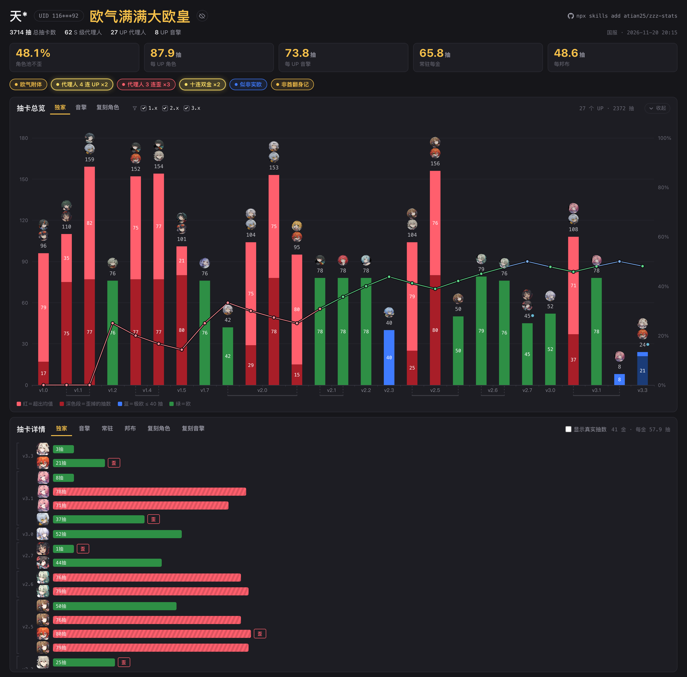

# 绝区零调频数据采集与报表

采集用户账号的调频数据 → 存成本地 JSON → 一条命令出 HTML 报表。

- **能拿到**：每个频道的总抽数、S 数、UP 数、UP 平均抽数、当前垫抽；每张卡池里**每一金**的物品 ID、名称、稀有度、是否 UP、消耗抽数、时间戳、频道内序号；覆盖版本范围。
- **拿不到**：4 星记录、逐抽记录、记录 ID。这些必须走游戏内 `getGachaLog` + authkey，不在本 skill 范围。



## 边界（必须遵守）

1. **绝不索取账号密码、验证码、cookie、token**。登录由用户自己完成（扫码）。
2. 不读取、不保存、不打印 cookie 与请求头。只取三个接口的**响应体**。
3. 除了「点一下登录按钮」和「点一下扫码图标」，不做任何自动化点击；不模拟抽卡、不改账号设置。
4. 数据只落本地 `output/<账号名>/`，不上传。

---

## 0. 浏览器：先看当前会话有什么能力

> **本节只描述「运行期」：怎么在这个会话里找到能打开官方页面、能扫码登录的浏览器。**
> 如果你是在**改这个 skill 本身**（编辑 `scripts/`、`assets/` / `config/` 之后要验收），
> 那不是采集任务——截图直接 `node skills/zzz-stats/scripts/screenshot.mjs`，不要按下面的优先级去现拼 Chrome 命令行。
> 两边的边界写在仓库根的 `AGENTS.md`。

> **`--preview`（README 头图）的隐私行为按数据集分两条路，别自己手点眼睛：**
> 脚本读产物里的 `report.meta.synthetic` —— 严格布尔 `true`（`fixtures/` 里的模拟数据，
> 名字本来就是「绳匠A」「绳匠B」这种编的）**不打码**，截图前反向断言昵称/UID 不含 `*`；
> 其余一切（含字段缺失、写成 `"true"` 字符串）**强制全打码**，并维持原来那条「必须含 `*`」的断言。
> **没有标记一律当真实数据**，所以新数据集忘了写标记只会让图难看，不会漏真名。
> 规则与理由见 `references/report-rules.md` §2.1。
>
> **`--preview` 按固定高度截图**（名义 1200 逻辑 px，`--preview-height <n>` 可覆盖），
> 不再整页截。内容一个不少，只是截到高度就停，超出部分天然不在图里，**两栏受同一高度约束**。
> 实测 `2880×2382`（逻辑高 1191）。实际高度会自动吸附到最近的「不切半行」位置（上下都试，取离名义值最近的）。
>
> **判据是行盒**（`getBoundingClientRect` 的整行，当前落盘实现就是这套）。
> 另有一版改成「墨迹信封」，它**没有**合进 master，只存在于分支 `backup/ink-envelope-176a153`
> （提交 `176a153`），量出来 1192 / `2880×2384`——与行盒版只差 1px，两版都是零半行。
> 要切换判据，先把实现 cherry-pick 进来、重出预览图，再改文档。
>
> 左栏行高 26、右栏 34，两栏行底边**交集为空**（绳匠A 41 行对 25 行、共享底边 0 个），
> 所以不能取「两栏各自最近底边的较小值」（1189 只保证左栏完整，它横跨右栏 1157~1191 那行）。
> 但交集为空不等于没有干净切点：左栏相邻行之间有 3px / 5px 间隙，右栏间隙恒 0、步长恒 34，
> 「右栏某行底边落进左栏间隙」的高度就是干净的。这种高度很稀疏
> （绳匠A 两栏都有行的 851 个整数高度里只有 6 个），必须逐像素搜索，不能靠公式算。
>
> **量几何前会断言页面视口高 == 截图视口高（900）**，不等就中止。行盒坐标是排版的产物，
> 而排版随视口高变化（首屏 `.screen` = `calc(100vh - 26px)`）：同一份产物视口 1000 时整页 2271、
> 900 时 2171。拿错视口的坐标判断切点会得出相反结论——真实踩过：按 1000 量会以为「两栏没有共同
> 安全切点」，其实 900 下 1191 本来就干净。
>
> **量不到几何 / 选择器量到空 / 上下都找不到安全切口，一律中止且不写文件**，
> 不会静默按名义值硬截（那样会安静地出一张切了半行的图，而尺寸自检永远是对的、拦不住它）。
>
> 改前两次都不对，别再走回去：最早是整页截（16 个版本组、图高 4342px，README 上一条细长条）；
> 上一版用 `--detail-versions N` **隐藏后面的版本组**——那是改内容，图里只剩 2 组而右栏还完整 25 行。
> 用户原话纠正：「抽卡详情和代理人汇总都是按固定高度截图即可，**不是让你过滤抽卡详情**」。
> 那个参数已整个删除，别再把它加回来。
>
> **页面本身不定高**（用户早前要求「不要定高吧，抽卡详情多的话就直接在页面下面」），
> 这是截图范围的固定高度，`.detail-body` / `.detail-list` 的 CSS 一行没动。

**不要假设存在某个具体工具。** 这个 skill 只需要 6 项能力，会话里有哪套就用哪套：

| 能力 | 语义 | 常见形态 |
|---|---|---|
| 打开页面 | 导航到 URL，能等条件成立 | `browser_navigate` / CDP `Page.navigate` / `moli fetch` / Playwright `goto` |
| 页内执行 JS | 在页面上下文跑 JS，支持 Promise | `browser_evaluate` / CDP `Runtime.evaluate` / `moli fetch --eval` / `page.evaluate` |
| 读写跨域 iframe | 枚举 frame、在 frame 内执行 | CDP `Page.getFrameTree`+`createIsolatedWorld` / Playwright `frameLocator` |
| 读网络（可选） | 列请求 URL | CDP `Network.*` / `moli --trace-network` / `page.on('request')` |
| 交图给用户 | 显示一张图 | 宿主图片组件 / GenUI / 存文件给路径 |
| 等等候 | 轮询直到条件成立 | 任何上面能力的组合 |

**优先级（从省事到兜底）：**

1. **会话自带的浏览器工具**（内建浏览器、moli、`browser_*`、宿主的 fetch 工具…）——有什么用什么，不要额外装东西
2. **Playwright**——环境里已经有就用，用 `channel:'chrome'` 驱动本机 Chrome，不额外下载浏览器
3. **零依赖 CDP**——前面都没有时的兜底，只用 Node 内置模块直连，自己起本机 Chrome

`scripts/collect.mjs` 已经实现了 2 和 3；如果你的会话属于情况 1，有两种用法：

- **简单**：只用会话自带的工具做「打开页面 + 扫码」，拿到登录态后，取数那一步仍然可以交给脚本（脚本支持 `--cdp` 连已开着的浏览器）
- **直接**：按下面 0.1 的 6 个方法写一个新的驱动文件，`collect.mjs` 不用改

```bash
node skills/zzz-stats/scripts/collect.mjs                 # 自动挑：有 Playwright 用它，没有用零依赖 CDP
node skills/zzz-stats/scripts/collect.mjs --driver cdp    # 锁定零依赖方案
node skills/zzz-stats/scripts/collect.mjs --cdp http://127.0.0.1:9222   # 连已开着的 Chrome，登录态可复用
node skills/zzz-stats/scripts/collect.mjs --headed        # 显示浏览器窗口，方便自己扫码
ZZZ_CHROME_ARGS='--no-sandbox --headless=new' node skills/zzz-stats/scripts/collect.mjs   # 受限沙箱
```

Playwright 装在 agent 自己的 profile 里也能被找到（自动搜索 `cwd` 祖先目录与 `~/.dsh/profiles/*`）；
也可以显式指定 `ZZZ_PLAYWRIGHT_PATHS=/path/to/node_modules`。

**本机完全没有浏览器、也没有浏览器工具时：** 请用户自己打开页面扫码导出，把 `data/` 里的 JSON 交给你；
**不要**要求用户去装浏览器插件。

### 0.1 换成别的浏览器实现时，只需对齐这 6 个方法

`scripts/drivers.mjs` 把浏览器能力收敛成一个非常小的接口，两个驱动都实现它。
如果某个 agent 有自带的内置浏览器，照着实现一份即可，**不用改 collect.mjs 的流程**：

| 方法 | 语义 |
|---|---|
| `open(url)` | 打开页面 |
| `evaluate(expr)` | 在主页面上下文执行 JS，支持返回 Promise |
| `waitFor(expr, ms)` | 轮询直到表达式为真 |
| `loginFrame()` | 拿到跨域登录 iframe 的句柄（内部要**轮询**，外层 iframe 挂上 ≠ frame 已就绪） |
| `evaluateInFrame(frame, expr)` | 在指定 frame 内执行 JS |
| `close()` | 收尾 |

**两条注意事项：**

- **点不动再找人。** 优先自动点：先按元素点（`element.click()` / `dispatchEvent`）。
  元素点不动时才退到坐标点击（有的实现只支持 `Input.dispatchMouseEvent`，会报
  `requires layout hit testing`）；坐标也不行，才请用户点一下。**顺序是自动 → 坐标 → 找人，别一上来就让用户动手。**
- **页内发请求。** 接口的 CORS 只放行 `act.mihoyo.com`，所以在**官方页面上下文里** `fetch`，
  不要新开 `about:blank` 或别的站点再发，那样会被拦。

---

## 1. 区服：默认国服

**默认走国服，不用追问**；只有用户主动说自己是国际服/亚服/美服等，才切换：

| | 国服（默认） | 国际服 |
|---|---|---|
| 页面 | `https://act.mihoyo.com/zzz/event/gacha-record/index.html` | `https://act.hoyolab.com/zzz/event/gacha-record/index.html` |
| 接口基址 | `https://act-api-takumi.mihoyo.com/event/nap_gacha_record` | `https://sg-act-public-api.hoyolab.com/event/nap_gacha_record` |
| region | `prod_gf_cn` | `prod_gf_jp` / `prod_gf_us` / `prod_gf_eu` / `prod_gf_sg`（按账号实际值） |

切换时只需 `--region` 传 region —— `scripts/collect.mjs` 会按 region 整套切页面与接口基址
（国服 `mihoyo.com` / 国际服 `hoyolab.com`），登录 iframe 的 host 判定也跟着切。
官方再换域名时用 `--api <url> --page <url>` 覆盖，或设 `ZZZ_LOGIN_FRAME_RE` 改登录 iframe 正则。
国际服的实际 region 值从 `/api/zzz/index` 的请求参数里读，读不到时按账号所在服务器兜底，并在结果里注明。

## 2. 打开页面并判断是否已登录

用 C1 打开页面，等到 `main.page` 出现（`document.querySelector('main.page')`），再用 C2 读状态：

```js
(() => {
  const root = document.querySelector('main.page');
  const text = document.body.innerText || '';
  return {
    cls: root ? root.className : null,               // 含 logged-out 表示未登录
    loggedOut: root ? root.className.includes('logged-out') : null,
    hasUid: /UID/.test(text),
    textLen: text.length,
  };
})()
```

判断：

- `hasUid` 为 true → **已登录**，跳到第 5 步。
- `loggedOut` 为 true → 未登录，走第 3 步。
- `textLen` 只有二三十、看到「加载中 100%」→ **标签页被节流了**。切到前台（或给页面一个真实视口/焦点），Vue 才会渲染出登录按钮。不要靠反复刷新。
- `cls` 为 null 且上面三个都不成立 → 页面没挂载成功，再等或重新导航一次。

### 2.1 扫码后：自动检测，还是提示用户回复「已扫码」（A / B 档）

| 档位 | 判据 | 做法 |
|---|---|---|
| **A（优先）** | 会话**支持等待** —— 能把进程挂起来、完成后再回来读结果 | 用后台任务启动采集并**挂着等**。检测到扫码完成就自动继续，用户什么都不用说 |
| **B（降级）** | 会话只能**一次性执行**，进程一返回就结束 | 交付二维码时明确告诉用户：**扫完后回复一句「已扫码」**，收到后再跑一次续上（登录态在 profile 里，不会要求重扫） |

判据只有一条：**这个会话能不能挂着等进程**。能等就别让用户回话；不能等就老实说清楚。

```bash
# A 档：后台任务 + 等待，自动检测到扫码
node skills/zzz-stats/scripts/collect.mjs            # 默认 a

# B 档：一次性执行，提示用户回「已扫码」
node skills/zzz-stats/scripts/collect.mjs --wait=b   # 或 ZZZ_WAIT_MODE=b
```

## ⛔ 等待扫码：只许一种写法

**扫码完成后必须在 1 秒内被感知。** 这是硬指标，不是「尽量」。

### 唯一正确写法

```
1. 后台启动采集          → 拿到 job_id
2. 读日志取出二维码 URL   → 发给用户
3. job_output(job_id, wait: true)   ← 阻塞在这里，进程一退出立刻返回
```

`wait: true` 是**事件驱动**的：没有超时轮询、没有固定等待，
采集进程退出的那一刻调用就返回，然后你立刻在对话里汇报。

### 明令禁止

| 写法 | 为什么错 |
|---|---|
| `node collect.mjs &` + `sleep 30` | 固定盲等。用户 3 秒扫完，也要等到第 30 秒 |
| `sleep 5` 然后查日志，再 sleep 再查 | 更糟：查完就走开，扫完了你还在做别的事 |
| 查一次日志就结束本轮 | **最常见的错**。用户扫完，对话流一片空白 |
| 前台直接跑不加 `&` 又不等返回 | 工具调用被占满，扫码期间无法给用户任何反馈 |

**任何 `sleep N` 出现在扫码流程里，都是 bug。** 没有例外，没有「这次先这样」。

### 为什么这条要写得这么死

它已经反复出错 4 次，症状完全一样：**用户扫完码，对话流没有任何反应**，
用户以为没识别到，于是重复扫码、反复询问。根因从来不是检测失败 ——
日志显示每次都成功采到了 —— 而是 agent 用 `sleep` 代替了等待，
把自己变成了「过 N 秒才看一眼」的盲人。

写下规则还不够，必须把 `sleep` 当成明确的禁止项来对待。

| 宿主能力 | 怎么写 | 效果 |
|---|---|---|
| 有后台任务 + 等待 | 后台启动 → `job_output(wait: true)` | 进程一结束**立刻**返回 ✅ |
| 只能前台执行 | 直接前台跑，不加 `&` | 一直占着，直到进程退出 ✅ |
| 都没有 | 降级 B 档，让用户回复「已扫码」 | 明确告知，别假装在等 ✅ |

**两种档位都要给用户可见的回应。** 扫码那一刻用户是盯着屏幕的：

| 时刻 | 对话里要出现 |
|---|---|
| 检测到扫码完成 | 「✅ 登录成功，正在取 6 个频道的数据…」 |
| 取数完 | 一句话汇总：UID / 总抽数 / 校验结果 |
| 全部结束 | 报表路径 + 关键指标，明确「完成」字样 |

**不要只打终端日志就算数**——用户不看终端。也不要闷头跑完才一次性汇报，
中段那几秒正是用户最没底的时刻。

**二维码卡片要紧凑**：只放「二维码图片 + 一行文字」。不要用 keyvalue 逐行罗列时间，
一项两行会把卡片撑得很高，白占屏幕。那一行文字**按档位写**：

> A 档：`15:34:21 生成 · 15:36:21 失效 · 扫完自动继续`
> B 档：`15:34:21 生成 · 15:36:21 失效 · 扫完回我一句「已扫码」`

两种档位都**必须传同一个 `--profile`**，否则 B 档第二次运行会丢登录态（Playwright 默认用临时 profile）。

## 3. 点「登录」，把二维码交给用户

### 3.1 先问一句：扫码还是短信？

| 方式 | 前提 | 怎么跑 |
|---|---|---|
| **扫码（默认）** | 用户装了米游社 App | `node skills/zzz-stats/scripts/collect.mjs` |
| **短信验证码** | 没装 App，或手机不在身边 | `node skills/zzz-stats/scripts/collect.mjs --login=sms` |

**必须先问**：不要假设用户装了米游社。一句话确认即可——
「用米游社 App 扫码，还是收短信验证码？」

## 输入通道：用户在对话里说，agent 送进进程

**用户不会操作终端。** agent 开终端跑脚本，是因为自己需要那个进程；
用户面对的只有对话框。所以脚本**不能**停下来等 stdin —— 那是个永远不来的输入源。

短信登录的两个值，都走「agent 转交」：

| 值 | 怎么给进程 | 说明 |
|---|---|---|
| 手机号 | `--phone=13xxxxxxxxx` | agent 在对话里问，拿到后直接传参 |
| 验证码 | 写入 `output/sms-code.txt` | 短信到了才知道码，文件是最顺的通道；登录成功即删 |

`--phone-file=<路径>` 和 `--code=<码>` 也支持，看哪种方便。
验证码文件**读一次就删**，不在磁盘留底；格式不对只提示、不退出，等下一个。

三条硬规则：
- 「获取验证码」**只点一次**，绝不自动重试（频繁请求会触发风控）。
- 验证码约 60 秒失效，agent 拿到就要立刻写入，别攒着。
- 脚本只把值填进官方表单，不代填、不猜、不落盘（除验证码文件的瞬时中转）。

### 短信表单长什么样（改代码前必读）

登录框是 Element UI，几个不写下来必然踩的点：

| 元素 | 选择器 | 注意 |
|---|---|---|
| 手机号输入框 | `input[placeholder*="手机号"]`，`maxlength=11` | 只收 11 位 |
| 验证码输入框 | `input[placeholder*="验证码"]`，`maxlength=6` | — |
| 区号 | `.area-code` 文本 `+86` | **写死的，没有下拉**，所以只支持国内号 |
| 协议勾选 | `input[type=checkbox]` | **不勾会卡在校验上**，必须在点发送前勾上 |
| 发送按钮 | 文本含「获取验证码」 | 未填手机号时是 `disabled` |
| 提交按钮 | 文本精确等于「登录」 | 同上 |

**填值必须用原生 setter + 事件，直接赋值 `el.value = x` 无效**（Element UI 读的是内部状态）：

```js
(() => {
  const el = [...document.querySelectorAll('input')].find(i => (i.placeholder||'').includes('手机号'));
  if (!el) return 'no-input';
  const setter = Object.getOwnPropertyDescriptor(window.HTMLInputElement.prototype, 'value').set;
  setter.call(el, '13xxxxxxxxx');
  el.dispatchEvent(new Event('input',  { bubbles: true }));
  el.dispatchEvent(new Event('change', { bubbles: true }));
  return 'ok';
})()
```

**表单是异步渲染的**：刚拿到 frame 时 DOM 里往往还没有这些 input。
必须**轮询等它出现**（等 ~10 秒），查一次就判「页面结构变了」是错的。

登录判定沿用 §4 的口径。提交后最多等 60 秒；仍无登录态就报「验证码错误或需要滑块验证」，
**不要重复提交、也不要重新发短信**。

只有**用户明确说自己在本机命令行手动跑**时，才会走 stdin 提问；
非交互环境下没给值会立刻报错说明，不会挂住。

扫码阶段的「换一张二维码」有两条通道，**并行生效、互不影响**：

- 终端里按 `r`（用户本机手动跑时）
- agent 写 `output/qr-refresh` 这个信号文件

**不要把它们当成二选一。** 进程挂在终端里（有 TTY）时，agent 同样发不了按键，
它只能写文件——所以 TTY 与否只影响提示文案怎么写，两条通道都得能触发刷新。
判断逻辑在 `scripts/qr-wait.mjs`（`takeRefreshRequest()`），信号文件被读到就删除，
一次请求不会变成连续两次重取。
（这个文件在登录成功后会被删掉，所以信号只在**登录前**还有意义。）

登录框是**跨域 iframe**（`user.mihoyo.com/login-platform`），外层 DOM 读不到，必须用 C3。

1. 用 C2 按元素点「登录」按钮。按钮可能 `disabled`（账号 SDK 未初始化）：报 disabled 就等 2–3 秒重试**一次**，不要连点。

2. 用 C3 等到登录 frame 出现，在 frame 内执行 JS：

   ```js
   // 在登录 frame 内
   ({ hash: location.hash, hasQrBtn: !!document.querySelector('.qr-login-btn--wrapper') })
   ```

3. **登录框默认是「短信登录」，不是扫码。** 要切到扫码：点 `.qr-login-btn` 这个图标（默认 32px，hover 才显示「扫码登录」气泡）。
   点不动就先试坐标点击，再不行才请用户点一下。

   **判断当前处于哪个模式，只认 `location.hash`，不要靠图片尺寸猜：**

   | hash | 模式 |
   |---|---|
   | `#/login/captcha` | 短信登录（默认落在这里） |
   | `#/login/qr` | 扫码 |

   踩过的坑：早先按「有没有 ≥120px 的图片」判断，但**短信页里本来就有一张 232×80 的横幅图**，
   于是误判成「已在扫码模式」，打印了一个根本不存在的二维码路径——用户拿着扫，扫半天没反应。
   正确的判据是 hash，再叠加「图片近似正方形」作为二次确认：

   ```js
   (() => {
     const qr = [...document.images]
       .filter(i => (i.src || '').startsWith('data:image'))
       .map(i => ({ w: i.naturalWidth, h: i.naturalHeight, src: i.src }))
       .find(i => i.w >= 120 && i.h >= 120 && Math.abs(i.w - i.h) <= 8);   // 近似正方形
     return { hash: location.hash || '', hasQr: !!qr, qr };
   })()
   ```

   实测真二维码 **260×260**；登录框里另有一张 60×60 的 logo 也是 data URL，靠上面的尺寸条件滤掉。
   切模式时首轮可能报 `no-target`（图标还没进 DOM），**多等几轮再判定**，别一次就报错。


4. **二维码是 data URL，直接读，不要截屏裁图。** 切到扫码后，frame 里会出现一张二维码 ``：

   ```js
   (() => {
     const imgs = [...document.images].filter(i => i.src.startsWith('data:image'));
     const qr = imgs.sort((a, b) => (b.naturalWidth * b.naturalHeight) - (a.naturalWidth * a.naturalHeight))[0];
     return qr ? { src: qr.src, size: [qr.naturalWidth, qr.naturalHeight] } : null;
   })()
   ```

   注意滤掉登录框里那张 60×60 的 logo（同样是 data URL）：按 **宽高 ≥ 120 且近似正方形** 筛。
   实测真二维码是 200×200 ~ 260×260。只有拿不到 data URL（比如二维码画在 canvas 上）时才退回截图。

5. **把二维码交给用户。先探测能力，再按探测结果降级。**

   不要假设任何宿主的组件名。先问自己三句话，落到哪一档就用哪一档：

   | 探测 | 结论 |
   |---|---|
   | 能把二维码**连同按钮/倒计时一起渲染成一块可交互的 UI**？ | 走 A 档 |
   | 只能把图片**内联显示在对话里**？ | 走 B 档 |
   | 只能把图片**存成文件**给路径？ | 走 C 档 |

   **A 档：动态 UI（宿主有 GenUI / 富组件 / 卡片渲染能力）**

   渲染一张「扫码登录」卡片，必须包含：二维码、截取时刻、失效时间、**倒计时**、**刷新按钮**。

   **二维码一律给图片 URL，不要把图形塞进对话。**

   同一张 260×260 二维码，三种交付方式的代价（已实测）：

   | 方式 | 对话里的字符量 | token 成本 | 结论 |
   |---|---|---|---|
   | **图片 URL**（`<image src="http://127.0.0.1:PORT/x.png">`） | ~60 | **~10** | ✅ 唯一采用 |
   | SVG 源码内联 | 7361 | ~2100 | ❌ **已废弃** |
   | base64 塞 `<image src>` | ~8200 | 组件丢弃 | ❌ 不支持 |

   **差 200 倍。** SVG 内联不仅贵（刷新 3 次就是 6000+ tokens 白烧），
   而且在流式输出里要等文本传完才开始渲染——用户先盯着一个灰块等半天。
   这个方案已经废弃，**不要再捡回来**。

   `collect.mjs` 内置了一个**只读图片服务**，采集时自动起、结束自动关：

   ```
   [zzz] 二维码图片服务：http://127.0.0.1:64262/（仅本机、只读、只服务 login-qr.png、取完即关）
   [zzz] 二维码图片地址：http://127.0.0.1:64262/login-qr.png?t=1795237780817-2
   ```

   把日志里那行 **`二维码图片地址`** 原样放进图片组件的 `src`。服务的**四条**约束：

   - 只监听 `127.0.0.1`，外网访问不到
   - **白名单：整个服务只服务 `login-qr.png` 这一个文件名**，其他路径一律 404。
     服务根目录是 `output/`，那下面就是账号数据目录（含 UID 与每金记录）——
     所以 `output/<账号名>/data/meta.json`、`output/<账号名>/report.html` 都取不到。
     先前的写法是「服务 .png 且锁在目录内」，换成 `output/` 当根之后那等于把整个账号目录挂出去。
   - 不认子目录、不认 `..`（白名单已经挡掉，这两条是第二道闸）
   - 端口由系统分配（`listen(0)`），不会撞车；采集结束由 `finally` 关闭

   **`?t=` 每次都不一样，只认最新那行。** 盘上文件名是固定的 `login-qr.png`（换图就是覆盖写），
   靠 URL 里的 `?t=<毫秒>-<序号>` 破缓存——所以**必须用最新打印的那条地址**，
   拿旧的 `?t=` 去渲染，缓存层可能还吐上一张已经作废的码。

   如果日志里**没有** `二维码图片地址`（服务没起来，例如环境受限），按下面降级：

   | 顺序 | 做法 |
   |---|---|
   | 1 | 宿主自己的文件路由（注意别把含 UID 的 `output/<账号名>/` 整体暴露） |
   | 2 | 给 PNG 文件路径（`output/login-qr.png`），让用户自己打开 |

   ⚠️ **`data:` / base64 塞进 `<image src>` 基本都不 work。** 多数富组件渲染器会丢弃
   `data:` 和 `file:` 协议（DSH GenUI 的 `image` 组件就明确不支持）。

   - **有效期按 120 秒**倒计时，顶部写清 `HH:MM 截取` 与失效时刻。
   - 倒计时归零 → 卡片切到「已过期」态，刷新按钮变为可用。**只改展示，不要自动去取新图。**
   - 刷新按钮要能**原地更新同一张卡片**（而不是每次刷新都新发一条消息）——用宿主支持的
     原地更新 / 面板（例如 DSH GenUI 的 `panel: true`、组件上的 action）来实现。
     **这个能力是可选的**：宿主不支持原地更新就退回「重新发一张卡片」，不要为此去猜私有 API。

   **B 档：只能内联贴图**

   直接显示二维码图片（宿主支持 base64 内联就内联；只吃文件路径就先落盘再引用），
   并在消息里写清「`HH:MM` 截取，约 2 分钟后失效，过期告诉我我再换一张」。

   **C 档：只能给文件**

   存成 PNG 并给出路径，明确让用户去打开它扫；同样要给出截取时刻和失效时间。

   **三档共同要求：**

   - **只认当次拿到的图。** `output/login-qr.png` 是固定文件名，盘上永远只有最新那张；
     历史截图一律禁止复用。
   - **把图交给用户、登录成功之后就不要再引用它。** 采集脚本会在登录成功那一刻删掉
     `output/` 下的二维码与验证码文件；你手里那条路径/URL 从此失效，
     不要再拿它渲染卡片、也不要让用户「回头再看一眼」——需要看就重新跑一次采集。
   - **换图要换 URL，不是换文件名。** 盘上固定 `output/login-qr.png`（覆盖写），
     靠 `?t=` 破缓存。拿旧 `?t=` 的地址去渲染，浏览器/图片组件/CDN 可能还显示上一张作废的码。
   - **刷新后必须重置计时起点。** 换到新码却还拿旧 `issuedAt` 算过期，新码一生成就被判失效——
     这个 bug 会让用户永远扫不到有效码，且只在「过期→刷新→继续等」路径下才显形。
   - **绝对不要做自动循环刷新。** 用户可能正好去忙别的事、没看对话流，
     你的定时器会在后台反复请求登录二维码——那是在锤对方的登录接口，有触发风控/封禁的风险，
     而且用户回来只看到满屏废弃的二维码。刷新**只能由用户主动触发**，并遵守第 7 步的限流。
   - 用户说扫不到时，先调大显示尺寸、确认白底静区；还不行再换一张。
   - **算好时间再发。** 二维码只有 120 秒，agent 从截图到渲染完卡片可能已过去几十秒。
     发出前确认剩余有效期，剩不到 60 秒就先换一张再发，别让用户拿到一张快死的码。

6. 告诉用户「请用米游社 App 扫码，约 2 分钟失效」，然后**停下来等用户回话**——不要轮询到超时再问。
   用户说扫不到/过期时，重拿一张再渲染，不要让用户自己去浏览器里找。

7. **刷新限流（硬约束）。** 二维码是对方登录接口下发的，频繁重取有风控风险：

   - 只在用户**明确要求**（「过期了」「刷新」「扫不到」）或用户点了卡片上的刷新按钮时才重取
   - **单次会话最多重取 3 次**；到上限就停下，让用户检查网络/换浏览器，不要继续重试
   - 两次重取之间至少间隔 **5 秒**，不要连发
   - 用户没有回应时**不要自行重取**：宁可停下来等，也不要空转
   - 如果连续两次都立刻失效，多半是登录态或风控问题，直接告诉用户，不要再刷

   > 没有 C3 时的降级：请用户在浏览器里自己点「登录」→ 点左上角扫码图标 → 扫码。你从第 4 步接着做。

## 4. 确认登录成功

用 C2 轮询（每 3–5 秒，最多约 2 分钟），命中任一即成功：

- 出现 `UID` + 6 位以上数字
- 出现「总调频次数」「调频资源总览」等已登录文案

扫码确认后页面通常 10–20 秒内**自己刷新**成统计页，不需要手动 reload，也不要重复点登录。一直不成功就回第 3 步重拿二维码。

## 5. 取 uid 与 region

用 C4 找 URL 含 `/api/zzz/index` 的请求，读它的 `uid` / `region` 查询参数。

- 找不到（例如打开时就已登录、请求发生在监听之前）→ **reload 一次**再读。
- 仍找不到 → uid 用页面显示的 UID，region 按 `prod_gf_cn` 兜底，并在结果里注明「region 为兜底值」。

## 6. 逐个接口取数

顺序：`index` → 6 个频道的 `hist_pool_stat` → 6 个频道的 `cur_pool_stat`，两次请求之间停 300–500ms。

```
{api}/api/zzz/index?uid={uid}&region={region}
{api}/api/zzz/hist_pool_stat?uid={uid}&region={region}&gacha_type={t}&vers={v1,v2,...}
{api}/api/zzz/cur_pool_stat?uid={uid}&region={region}&gacha_type={t}
```

- `{t}` 依次取 `2, 3, 102, 103, 1, 5`（独家 / 音擎 / 独家重映 / 音擎回响 / 常驻 / 邦布）。
- **`vers` 必须用该频道自己的 `type_stats[].has_data_vers`，且单次最多 10 个。** 用所有频道的并集、或一次塞 20 个版本，接口会返回 `-400005 参数错误`。
- 版本数超过 10 时分片：按版本号降序每 10 个切一片，逐片请求，再把各片的 `data.list` 合并去重。页面自己只拉最近 8 个版本，分片才能拿到更早的历史。

**取数方式：在官方页面的上下文里 `fetch`。** 一次导航，后面全部页内请求，比「导航到接口 URL 再读 body」快一个数量级：

```js
// 在 act.mihoyo.com 页面内执行：只有这个源被接口的 CORS 放行
const BASE = 'https://act-api-takumi.mihoyo.com/event/nap_gacha_record/api/zzz';
const qs = `uid=${uid}&region=${region}`;
const get = async (path, extra = '') => {
  const url = `${BASE}${path}?${qs}${extra ? '&' + extra : ''}`;
  const res = await fetch(url, { credentials: 'include' });
  return res.json();                       // { retcode, message, data }
};

await get('/index');                                       // 汇总
await get('/cur_pool_stat', 'gacha_type=2');               // 当前卡池
await get('/hist_pool_stat', 'gacha_type=2&vers=3.3,3.1');  // 历史（versions 自己分片）
```

> 若宿主用 `browser_evaluate` 这类会包一层字符串的工具，把上面的脚本写成**文件**再传（C2 的「长脚本走文件」）。
> 只有在无法页内 fetch 时才退回「导航到接口 URL + 读 `document.body.innerText`」；那条路径记得先截到第一个 `{`，并关掉临时标签页。

### 6.1 两条路线，按会话能力选

**路线 A：跑脚本**（会话里有命令行、能起浏览器）

```bash
node skills/zzz-stats/scripts/collect.mjs
```

**路线 B：只借两个能力**（会话里有浏览器工具，但跑不了/不想跑 Node 脚本）

取数逻辑本身很简单，只要你能「打开页面」+「在页面里执行 JS」：

1. 用会话自带的工具打开官方页面，让用户扫码登录
2. 把 `scripts/fetch-in-page.js` 的**整个文件内容**作为表达式执行
3. 把返回的 JSON 交给 `node skills/zzz-stats/scripts/save-in-page-json.mjs` 落盘（或你自己拆成 `data/` 那几个文件）

```bash
node skills/zzz-stats/scripts/save-in-page-json.mjs --in result.json   # 或 echo '<json>' | node skills/zzz-stats/scripts/save-in-page-json.mjs
```

这条路不依赖 Playwright、不依赖 CDP、不要求本机开调试端口——**只要有「页内执行 JS」这一个能力就够**。
`fetch-in-page.js` 会自己处理频道顺序、`vers` 分片、去重和 `retcode` 校验。

> 两条路线产出完全一致，都会走同一个 `build-report.mjs`。
> 差别只在「谁来驱动浏览器」：A 由脚本驱动，B 由会话自带的工具驱动。

**建议直接跑 `scripts/collect.mjs`**，它把 A 路线都包好了；只有在用 B 路线时才需要手动粘脚本。

## 7. 落盘

**数据写到「用户工作目录」的 `output/<账号名>/data/`，不要写进 skill 自己的目录**
（skill 升级会覆盖，也容易误提交）。

> 实现依据：脚本把两个根目录分开——`SKILL_DIR` 是 skill 本体（`config/`、`assets/`，只读），
> `WORK_DIR` 是数据落点（`output/`、`.chrome-profile/`，可读写）。
> `WORK_DIR` 取 `--cwd` 参数，没传就取 `process.cwd()`。
> 所以装到 `.agents/skills/zzz-stats/`（甚至全局 `~/.agents/skills/`）之后，
> 在**自己项目目录**里跑 `node <skill>/scripts/collect.mjs`，数据就落在自己项目下；
> 要指定别处就加 `--cwd /path/to/project`。

```
output/<账号名>/data/meta.json
output/<账号名>/data/index.json
output/<账号名>/data/cur_pool_stat_<t>.json
output/<账号名>/data/hist_pool_stat_<t>.json
```

**`<账号名>` 是昵称**：登录后从页面文本读，读不到（`null` / 空 / 全是非法字符）就退回 UID。
昵称做文件系统安全化后使用——去掉 `/` `\`、控制字符、Windows 非法字符，去掉首尾空格与点，
拒绝 `..`；emoji、空格、`·` 允许。**同账号重跑 = 覆盖同一个目录**，不报错、不生成 `xxx-2`。
安全化规则在 `scripts/datasets.mjs`，五个脚本共用同一份实现。

- 写之前校验 `retcode === 0`；`-100` 说明登录失效，回第 3 步。
- `meta.json` 至少含：`schema`（`zzz-stats/v1`）、`server`、`uid`、`region`、`fetched_at`、`versions`、`source`，以及 **`nickname`**。
- 昵称不在任何接口里，只能从页面 DOM 文本读（登录后标题处的名字）。读不到就留空，报表会显示 `—`。
- JSON 原样保存，不要改字段名、不要转时间格式。

## 8. 校验

```
sum(cur_records[].count) + type_stats[].next_s_cur_times == type_stats[].total_count
```

逐频道比对。左边是「已出金抽数 + 当前垫抽」，右边是官方总抽数——**它校验的是抽数，金数对得上但记录缺抽也会在这里露出来**。`scripts/build-report.mjs` 会自动跑这条并报警（校验仍在构建期外壳，不在 core —— 理由见「分层」那节）。

另外两条容易踩的：

- `index.total_gacha_count`（实测 3714）与 `total_s_count`（实测 62）**都不含邦布**。六个频道相加是 5375 / 96。报表里两个口径要分开写清楚。
- `sort` 是**频道内跨池连续**的全局序号（各频道各自从 1 开始），不是账号全局、也不是池内序号。`count` 恒等于相邻两条的 `sort` 差。

## 9. 出报表：直接用模板，不要重新发明

```bash
# 不传 --data 时只看 output/<账号名>/data/，只有一份就直接用；有多份或没有都会报错退出，不猜
node skills/zzz-stats/scripts/build-report.mjs
# 多份时明确指定；产物默认 output/<账号名>/report.html
node skills/zzz-stats/scripts/build-report.mjs --data output/<账号名>/data
# 指定落点（相对 WORK_DIR，或写绝对路径）
node skills/zzz-stats/scripts/build-report.mjs --data output/<账号名>/data --out output/my.html
```

> **参数两种写法都支持**：`--out output/x.html`（空格）和 `--out=output/x.html`（等号）。
> 这条专门记下来，因为早期两个脚本都只认空格形式，传等号会被**静默忽略、悄悄用默认值**——
> 不报错、不提示，你以为写到了 A，实际写在 B。`collect.mjs` 的 `--login=sms` 和
> `build-report.mjs` 的 `--out=` 都栽过。改参数解析时，两种形式都要覆盖。

输出 **`output/<账号名>/report.html`**（已被 `.gitignore` 忽略；换用 `--out` 可改）。

**一条规则：产物永远落在数据集目录的上一级，名字固定叫 `report.html`。**
运行期结构下数据集目录是 `output/<账号名>/data/`，上一级就是 `output/<账号名>/`——
数据和报表在**同一个账号目录里**，用户拿走 `output/<账号名>/` 这一个目录就能直接部署，不用自己判断
哪些文件配哪份报表。名字不再带数据集后缀（`report-<数据集名>.html` 已废弃），因为账号目录已经区分开了。

显式 `--data fixtures/baseline`（开发期）时，数据集不在 `output/` 结构里，这时**不会**往 `fixtures/`
里写产物——改取该数据集 `meta.json` 的昵称，落到 `output/<昵称>/report.html`，昵称拿不到就用目录名。
**真正的单文件**——数据、ECharts、以及用到的图标全部内嵌，
可以直接发给别人、单独打开，不需要附带 `assets/` 目录。
控制台会打印关键指标与校验告警——**把这些告警当失败处理，不要带着告警交付**。

**「改配置就生效」是硬约定**：配色经 CSS 变量注入（`--accent` / `--detail-good` / `--detail-bad` / `--loss-stamp`），
面板标题与勾选文案在构建时替换模板占位符（`copy.chartTitle` / `copy.detailTitle` / `copy.mergeToggle`）。
新增配置项时也要按这两条通道接上，**不要在 CSS/JS 里另写一份硬编码**——那会让配置变成摆设（踩过）。

**成本口径一律扣垫抽**：每金 / 每 UP 均用「官方总抽 − `next_s_cur_times`」，与官方 `avr_up_count` 对齐；
垫抽进度由 `channels[].pityCap`（常驻/独家/重映 90、音擎/回响/邦布 80）算出百分比，
**只显示在第二屏详情正文里**（问号方块 + 绿色斜纹条），主图面板头不放。

**默认不要读 `references/report-rules.md`。** 模板已经实现全部规则，一条命令就是完整产物。
只有当下面任一情况成立时，才去读那份规范：

- 用户要**定制版式**，模板给不了
- 你要**改口径 / 改配色 / 改标签逻辑**
- 模板跑出错误，需要判断是数据问题还是实现问题

### 9.1 产物里有哪些交互（向用户描述功能时照这个说）

产出的 HTML 是**可交互**的，不是静态图。宿主 agent 介绍产物时别把它说成「一张图」：

| 交互 | 位置 | 行为 |
|---|---|---|
| **频段 tab** | 主图面板头（`抽卡总览` 右边） | 在「独家 / 音擎 / 独家重映」之间切数据集。只给**有 50/50 且真的折出了 UP 轮**的频道出 tab；只有一个频道时不显示。切 tab 时版本过滤选择会保留 |
| **版本过滤** | 频段 tab 右边（漏斗图标 + `1.x`/`2.x`/`3.x`） | 多选，控制显示哪些版本段的柱子。**默认全选中＝不过滤**；全部取消＝回到全显示（不是画空图）。选中态是「灰框 + 勾」，未选中是「灰框 + 短横」，**靠形状区分、不用颜色**（金色在这份报表里代表「欧气」，勾上不等于好运，所以过滤器不碰金色） |
| **隐私三态** | 右上角眼睛图标 | 点击循环 0 全显示 → 1 仅打码 UID → 2 全打码。**对外截图先点到 2**；`--preview` 例外——`meta.synthetic === true` 的模拟数据集不打码 |
| **详情频段** | 第二屏 `抽卡详情` | 6 个频段标签（独家 / 音擎 / 常驻 / 邦布 / 独家重映 / 音擎回响），切该频段的逐金列表。**列表不定高、不内部滚动**：内容多就往下长（独家 41 行实测 1231px），整页跟着变高——用户要的就是这个，方便整页截长图。切 tab 时页面高度会变，这是流式布局的固有行为，不是 bug |
| **代理人汇总（右栏）** | 第二屏 `抽卡详情` 右边，与左侧标题同级同行；**≤720 一列时移到右栏正上方，且分隔线在它上方** | **独立分栏，不跟 tab 走**：全账号跨全部频段合并、只统计角色（音擎 / 邦布不进）。**UP 角色**显示影画（全部频段出现次数 − 1）、一共多少抽（**它各轮 total 累加**，含期间歪出的；雅 = 152+154+78 = 384）、**歪 N 次**（算欧的不标红，见下）、行尾欧非 emoji；**均抽只在悬浮 tip 末行**。**非 UP 角色只显示影画**，不显示抽数和标记。排序是 UP 在前、非 UP 在后，各组按最后获得时间倒序。**行高 34px**（不是 44），名字用 sans、数字用 mono。19 个 UP 抽数合计须闭合到官方 2448，构建期有断言 |
| **真实抽数** | 详情面板头右侧 | 勾上后把歪掉的抽数并进下一个 UP，只留 UP 行 |
| **详情版本过滤** | `真实抽数` 右边（漏斗 + `1.x`/`2.x`/`3.x`，形态与主图那排一致） | 多选，**只筛「抽卡详情」左栏显示哪些行**。默认全选中＝不过滤；全部取消＝回到全显示（不是画空列表），与主图同一约定。**右栏「代理人汇总」一行都不受它影响**（那栏是跨全部频段的全局聚合，筛了会让影画编号和抽数对不上）。**与主图那排是两个独立状态**：主图只影响柱子、这排只影响左栏，勾一个不会带着另一个变。某档位在该频段没数据也照画 chip（按频段增删会让切 tab 时这排宽度跳变）。筛空时显示「当前版本筛选下没有记录」，**不沿用**「这个频段还没有 S 级记录」——后者在那个状态下是假话 |
| **悬浮提示** | 柱子 / 标签 / 详情行 | 自绘深色气泡：柱子给本轮抽数构成，标签给具体轮次（版本 + 角色链）。**标签悬浮时联动高亮，按标签类型分两类**（分类由 `config/report.json` 的 `highlight` 字段声明，新增标签只改配置）：<br>**A 类**（`非酋翻身记` / `薛定谔的非酋`，跟不歪率有关）——柱状图**整片**压暗、柱顶数字与头像一并变暗，**不歪率折线整条置顶并加粗提亮**，因为它讲的是整条曲线的形状、没有「命中柱」；不给任何柱画白描边。<br>**B 类**（多金 / 连段 / 似非实欧 / 欧气附体等，绑定具体柱位）——**双向**：未命中的柱压暗、命中的那几根柱所在区域**背景主动提亮成一块亮区**（柱体本色不受影响），柱顶数字与头像按命中与否逐项调暗，命中柱另加白描边点名 |
| **收起主图** | 面板头右侧 | 折叠主图，方便把 KPI 和详情截进同一屏 |

**版本过滤不影响不歪率折线**：折线始终是**全局累计**，过滤只缩柱子。
这条是用户定死的口径，向用户解释时别说成「过滤后折线也变了」。

**折线本身按不歪率三档分段着色**（档位见 `config.numbers.winRateTiers`，色值见 `colors.winRateUnlucky/Schrodinger/Lucky`）：
`< 35%` 红（非酋）· `35~50%` 绿（薛定谔带，还没定型）· `≥ 50%` 蓝（欧）。
折线**自带深色描边**（`colors.winRateHalo`），因为提亮后的线压在同类色柱子上对比度只有 1.3~2.3:1；
描边不是装饰，是三档同时可读的唯一手段，不要去掉。右轴固定 0~100%，所以跨账号、跨频道的同一档位永远在同一高度。

### 9.2 报表里有哪些标签

标签由 `config/report.json` 的 `tags.rules` 驱动，条件不满足就不出现——**不同账号标签不一样，不要照抄示例**。

| 标签 | 含义 |
|---|---|
| `欧气附体` | 十连出过多金，或有极欧柱 |
| `代理人 K 连 UP ×N` / `代理人 K 连歪 ×N` | 连续直出 / 连续先歪，**每个不同长度各出一条**，3 连起 |
| `十连双金` / `十连 3 金` / `十连 4 金` | 十连多金，**按一组的金数分档**（2 金写「双金」，3 金以上写阿拉伯数字）。统计范围是**角色池 + 音擎合并**；每个档位单独计数 |
| `似非实欧 ×N` | 先歪了但总抽数低于该账号每 UP 均 |
| `非酋翻身记` | 曾经掉进非酋档（累计不歪率谷底 < 35%）、现在爬出来、涨幅 ≥ 15pp。tip 写「最低 / 最高 / 当下」三点（各带版本号），不写涨幅 |
| `薛定谔的非酋` | 历史上有过**非酋↔欧的来回横跳**（完整滑动窗口序列上切换 ≥ 2 次）。**这描述的是过去发生过的事，不是当前状态**：一个号可能早已稳定，标签仍然成立。所以 tip 会带出版本区间和「最近一次在 N 轮前」，**读到的时候要看那串版本号**，不要当成「它现在还在跳」 |

**`十连 N 金` 必须按金数分档**：把三金写成「十连双金」是事实错误，总数也会跟着错。
多金组按「同秒且 `sort` 差 ≤ 9」判定，且必须**先按频道分段再各自成组**（不同频道的 `sort` 各自从 1 数，混着算会凭空多出多金）。

### 详情右栏：角色维度汇总（口径别猜）

第二屏 `抽卡详情` 是**左右两栏**：左边是原来的逐金列表（一行没动），右边是**代理人汇总**。
两个**同级的栏标题**并排在同一行：「抽卡详情」（左）…… 「代理人汇总」（右），各贴自己那一列。
`抽卡详情` 的左边缘对齐左栏内容（= 每行最左的竖括号 x），`代理人汇总` 对齐右栏第一个头像（两列时）。
塌成一列后这条不适用：「代理人汇总」改为对齐兄弟栏标题「抽卡详情」（下面另有说明）。

频段 tab / 「真实抽数」都在**同一行**（`.detail-head-main`，跟着「抽卡详情」）。
**这里已经没有 meta（「41 金 · 每金 57.9 抽」）了**——它是这一行最宽的一块（1440 实测 123px），
也是 800 下 tools 折行的直接原因；用户原话「显示真实抽数换行了，可以考虑把后面的总结全局去掉」（引的是当时的按钮名，**按钮现已简称「真实抽数」**）。
去掉的是**总结数字本身**，不是换个地方显示：顶部 KPI 卡与右栏已各有自己的口径，再写一遍是重复。
800 宽下靠按钮名缩短（「显示真实抽数」→「真实抽数」，1440 实测 87 → 64，省 23px）
加上列间距 `--detail-head-gap`（≤840 为 6px）才能一行放下，**不缩字号、不裁文字**——控件必须能点能读。
> 归因别记错：**一行是那 23px 的功劳**，不是基线 CSS。只上四条基线改动、按钮名仍用长的，
> 790/800 实测仍是两行（46px）；反过来只回退字号（保持新文案）仍是一行。
> 间距只是边界条件：实测把 gap 放大到 12px 时 790 仍一行、14px 才折行。

这一行的**垂直基线**靠 `.detail-tools` / `.merge-toggle` 的 `align-items: baseline` 对齐，
checkbox 自己用 `align-self: center` 居、不参与基线计算，勾选框文字与 tab 字号统一 **12px**。
**不要退回 `center`**：那会让行内基线取到 13×13 checkbox 的中线，文字整体抬高 3.5px
（1440 实测：改前「真实抽数」bottom 900.5、标题 bottom 904；改后两者差 **0**）。
790 / 800 / 1000 / 1440 改后都是 `dMerge = 0` 且头部一行（44 / 29）；
721 / 760 仍是两行（61 / 46，那是断点内正常折行，`dMerge` 跨行不可比）。
**按钮名不要再改回「显示真实抽数」**：多出的 23px 会让 790/800 重新折行。

**「真实抽数」紧跟 tab，不靠右边缘**。`margin-left` 是 **2px**，不是 `auto`——
`auto` 会把整组推到最右，右边缘到左栏内容右缘**恒为 0px**（每一档都贴线，
用户原话「跟右边的线贴到一起了」）。改后 790 左距 14 / 右余 4、800 是 14 / 14、
1000 是 22 / 198、1440 是 22 / 578，**右余每档都 > 0**。也别改成 `0`：790 左边只剩 6px，
比改前的 18px 还挤。**不许加 `justify-content` 去「调匀」**，用户要的就是「紧跟」这一个效果。

**tab 与合并开关之间有一条 1px 竖向虚线**（`#3a3a45`，用户原话「中间加个虚线啥的吧，
好区分 tab 和 配置」），靠 `.detail-tabs` 的 `padding-right: 5px` + `border-right: 1px dashed`
实现，配合 `.detail-tools` 的 `margin-left: 2px`，三者合计 **8px**——与加线前的
`margin-left: 8px` 净占用完全相等，所以各档位置零变化。
**不许改成给 `.detail-tools` 加 `border-left`**：那会真的多占宽度，790 会挤爆（实测左 6 / 右 3）。

**详情区不定高、不内部滚动**（用户原话「不要定高吧，抽卡详情多的话就直接在页面下面，
方便滚动截图」）。左右两栏**都按自己的内容撑开**，整页跟着变高，可以直接截整页长图。

- **改前 vs 改后**：改前是左栏 `height: 480px` + `overflow-y: auto`，右栏靠绝对定位的
  `.detail-chars-fill` 拿到左栏那 480 再自己滚（窄屏还有 `max-height: 8 × 34 = 272`）。
  改后这些全删：`.detail-chars-fill` 回 `position: static`、两处 `overflow-y: auto` 去掉。
  `.detail-body` 的 `align-items` **保持 `stretch`**（曾经改成 `start`，已推翻，见下）。
- **为什么是 `stretch` 不是 `start`**：`.detail-chars` **没有背景色**，盒子被拉长不产生任何可见空白；
  右栏唯一看得见的是 `border-left` 那条 1px 竖线，而它的**长度就等于盒子高度**。
  所以盒子高度直接决定那条线画到哪。
  - `start`（被推翻那版）：`.detail-chars` 高 854，竖线到 **1873** 就断，左栏到 2250 ——
    下面 377px 没线，看起来像右栏内容没加载完。实测 1440/1000/800 三档都是这个位置。
  - **`stretch`（现在）**：盒子被拉到 1231，竖线画到 **2250**，与左栏底边齐平。
  - 两版 `.detail-chars-body` 的内容高**都是 854**（25 × 34 + 4），一点没变；
    变的只是外层盒子和那条线的长度。**别拿「内容高 854」自证 `start` 更好**。
  - 曾经的信条「最后一行到底边 > 34px 就说明被拉长」已作废：`stretch` 下那个距离是 381px，
    但它量的是**不可见的盒子**，不是用户看得见的东西。
- **运行期口径**：切频段时页面高度会变（独家 41 行最高、音擎回响 1 行最矮），
  这是流式布局的固有行为，不要说成 bug，也不要为了「不跳」把定高加回来。
- 实测（`fixtures/baseline`，四档 1440/1000/800/720）：两栏的 `overflow-y` 全部是 `visible`
  （页面里不再有滚动容器）；行高仍 `[34]`、emoji 间距仍单值 `[6]`、
  `marginLeft` 有歪 `0px` / 没歪 `-6px` 未变。1440 独家整页高 **2271px**（改前 1520，因为当时被压在 480 里滚）
  ——这个数字是**视口高 1000** 时量的，首屏 `.screen` 是 `calc(100vh - 26px)`，整页高会跟着视口走；
  视口高 900 时同一页是 2171（改前 1420）。

**窄屏（≤720）塌成一列**时，「代理人汇总」跟着它管的右栏走：顺序是
「左栏列表 → 20px 空白 → 一条横线 → 代理人汇总 → 右栏」，横线是标题自己的上边框，
`.detail-chars` 不再画线（只许有一条）。标题左内边距 **14px**，让它的第一个字和
**「抽卡详情」标题**落在同一条竖线上（`21 卡片内沿 + 14 = x=35`）。
一列模式下两个栏标题竖着排，读者会拿它们互相比，所以对齐的是**兄弟栏标题**，
不是右栏角色名的缩进（中间那版写 38 去对名字，量出 x=59、差 24px，被用户打回：
「角色汇总应该左对齐，类似抽卡详情」）。角色行自己的缩进不动。
两列时（≥721）这套一律不生效，仍是 16px 内边距对齐右栏第一个头像。

**页面铺满宽屏，五张卡左右边缘严格对齐**（用户反馈「分栏感觉太宽」「两边空的」）。
左边缘统一在 `x = 20`（`--page-gutter`），右边缘统一在 `视口 − 20`，1920/2400 也一样铺满，
**没有整页限宽**。用户说过的「太宽」根因不是卡片撑满视口，而是**左栏内部用不满**——
1440 下限宽前左栏 1086、而 41 行抽数条最右只到 629，右边白掉 429px。
真解是**抽数轨道跟着左栏伸缩**（`flex: 1 1 0`，不再写死 553px），左栏多宽轨道就多宽，
所以页面可以放心铺满。实测八档（760~2400）：首屏 4 块与详情卡左右边缘极差都是 **0**，
41 条轨道全在且等宽，轨道右沿与列表内容盒右沿齐平（剩下的 14px 是 `.detail-list` 自己的
`padding: 6px 14px`，不是布局漏白；判据是**轨道右沿对齐容器**，不是「条的右端贴容器边」——
条的右端停在 `抽数/本视图分母` 的位置上，那是数值不是空白），整页横向溢出 0。

**左栏每条抽数条的长度＝「这个频道里谁最贵」，不是跨频道可比的绝对刻度。**
分母是**该频道当前视图自己的最大抽数**（不足时用该频道的保底上限兜底：
常驻/独家/独家重映 90，音擎/音擎回响/邦布 80），由构建期算好、写进产物的 `details[].divisor`，
前端只用不算。所以同一视图内抽数越多条越长、不同的抽数一定画出不同的长度
（例外只有两端都被 44px 保底钳住的极短条）。
**改前是写死的 `/100`**：超过 100 抽的全部封顶满宽，1440 独家「真实抽数」下 104 抽和 159 抽
都是 948.11px，肉眼分不出——所以换成了现在这套。
**详情条不必和上方主图同轴**（用户明确说过两者各自独立）：主图比的是「每轮成本」在固定 Y 轴里的位置，
详情条比的是「这个频道里谁最贵」，单位刻度都没画，读者不会跨图比长度。
配置里**没有** `detailBarDivisor` 了（已删，别加回来），只有 `detailBarMinPx`（44，条的最小宽度）。
**条里的字不许被裁**：`.detail-bar` 带 `min-width: max-content`，短条按文字宽度撑开
（800 宽邦布的垫抽条「已垫8抽」需要 48px，改前被 44px 卡住溢出 4px，改后 48.03px、溢出 0）。

**别再加整页限宽**（`--page-max` 那套已废弃）：1920 下整页只剩 1000、左右各空 460，
等于把「只有详情卡窄」换成「所有卡一起窄」，用户抱怨的问题原封不动。
**右栏和左栏是两个独立的分栏，不联动**：左栏跟着频段 tab 走，右栏是**全账号跨全部频段合并**的汇总，
切 tab 右栏一行都不变。

右栏按「这个角色有没有当过 UP」分成两类，**显示的东西不一样**：

| | 影画 | 一共多少抽 | 歪 | 悬停 tip |
|---|---|---|---|---|
| **UP 角色**（当过 UP） | ✅ | ✅ 它**各轮 total 累加** | ✅ 追它时歪过几轮 | 每次获得一行 + 末行均抽 |
| **非 UP 角色**（从没当过 UP） | ✅ | ❌ 不显示 | ❌ 不显示 | 逐影注明每只的来源（常驻 / 抽哪个 UP 时歪出 / 十连副金） |

**UP 角色**：

- **影画** = 该角色在**全部频段**记录中出现的次数 **− 1**。第 1 只给 **0 影**。
  **这是按记录反推的，不是游戏里读到的影画等级**——超过 7 只（6 影后继续抽）会照实显示 7，旁边标「超上限」。
- **一共多少抽** = **该角色每一轮那一轮的 `total` 累加**。一轮 `total` = 期间歪出的抽 + 这一只自己的
  `count` + 十连副金，所以雅 3 只 = 152+154+78 = **384 抽**。
  大保底那一只必须把前面歪掉的抽算进成本：只取 `count` 会算成 230，凭空少掉 154 抽，
  那正是「为了拿到它先歪出去的成本」。
  这个口径自带闭合校验：19 个 UP 合计等于官方 2372 + 76 = **2448**，构建期有断言拦着。
- **歪 N 次** = **为了追它，歪过几轮**（走 `buildRounds` 的轮次模型，`round.off > 0` 或 `guar`）。
  不是「`is_up === false` 的记录条数」——那个数在非 UP 角色身上是「它被别人歪出来了」，语义完全不同。
  **两处都显示**：行内（抽数之后、emoji 之前）+ 悬浮 tip 末行均抽后面。
  用户先说过「歪 N 次 这个放 Tip 吧」（于是只留 tip），后来又改成「歪 N 次也放外面吧」，
  所以**现在行内也恢复了**，两处重复是用户明确接受的。

**非 UP 角色只显示影画**（用户原话：「非 UP 角色显示几命即可」）。这些角色从没当过 UP，
给它们算「一共多少抽」没有意义（抽数属于把它歪出来的那个 UP），而「歪了几次」在它们身上恰好是反的。
数据层仍保留 `pulls` / `lostOut`，**界面不渲染**。

**非 UP 角色的 tip 逐影注明来源**（用户原话：「珂蕾妲•5影・没当过 UP 这 tip 不好，不要写
"没当过 UP"，然后换行注明下它的每一影的分别来源，是常驻多少抽出的还是抽哪个 up 多少抽歪的」）。
改前只有一行 `珂蕾妲 · 5 影 · 没当过 UP`；改后是第一行 `珂蕾妲 · 5 影`，下面每影一行：

```
珂蕾妲 · 5 影
本体：抽「雅」时 77 抽歪出 · v1.4
影画1：常驻 6 抽 · v1.6
影画2：抽「橘福福」时 15 抽歪出 · v2.0
影画3：常驻 79 抽 · v2.3
影画4：抽「叶瞬光」时 80 抽歪出 · v2.5
影画5：抽「菲欧妮」时 21 抽歪出 · v3.3
```

三种措辞对应三个**真实来源**，别混用：

| `kind` | 措辞 | 含义 |
|---|---|---|
| `perm` | `常驻 N 抽` | 常驻频段直接出。**N 是「距上一个金」的抽数，不是获取成本**——常驻没有轮次模型 |
| `lost` | `抽「X」时 N 抽歪出` | 抽 X 时歪出来的，N 是那一金自己的 `count` |
| `side` | `抽「X」时十连副金` | 十连里跟在 UP 后面的副金。**不能写「N 抽」**：它的 `count` 恒为 1，写「1 抽」会被读成「一抽就出」 |

版本号保留、**日期省略**（一行已经很长，`.tip` 是 `white-space: pre` 且 `max-width: 420px`，超了是横向裁掉不是折行）。
`sources` 为空或条数对不上时退回 `珂蕾妲 · 5 影` 纯摘要，**不输出半截内容**（半截列表会被当成完整答案）。

**为什么影画必须跨频段合并（这条别改回去）**：独家频段能歪出常驻角色，同一个角色的重复获取会散在不同频道里。
按频道分开算影画**必然少算**——`fixtures/baseline` 实测：珂蕾妲 独家 4 次 + 常驻 2 次，分开算得 3 影 + 1 影，
正确影画是 **5 影**；猫又 独家 2 + 常驻 2，分开算各 1 影，实际 **3 影**。

**右栏只收角色**（`item_type === 'ItemType_Avatar'`）。音擎和邦布没有影画概念，不进右栏；
常驻频段里抽到的角色照常计入（它们是角色）。实测 baseline 全局 **25 个角色 / 47 条角色记录**
（其中 19 个 UP、6 个非 UP；UP 组歪轮合计 14，抽数合计 2448）。

**抽数口径被改错过两次，构建期有闭合断言兜着**：UP 角色 `pulls` 之和必须等于
独家 + 独家重映的官方已抽数，不等就 `fatal` 退出 1 且不写产物。
所以改动这块之后如果构建失败并打印「右栏 UP 角色抽数合计 N ≠ 官方已抽 2448」，
**先想想是不是又把「各轮 total」换成了「UP 那条 count」**。

**排序**：**UP 角色在前、非 UP 在后**；两组各自按**最后获得时间倒序**（该角色所有记录的 `record_time` 最大值），
最后按 itemId 稳定排序。不按名字（中文名排序对读者没意义），也不按出现次数（那样「从没 UP 过但最近刚拿到」的
珂蕾妲会压在最新的 UP 角色上面）。

**左栏（`抽卡详情` 列表）每行的 tip 第一行带「· 本体 / · 影画N」**
（用户原话：「菲欧妮・本体/影画一 —— 在 up 角色后面也加下这个」）：

```
菲欧妮 · 本体
v3.3 · 2025-08-01 12:34
距上一个金 3 抽 · UP
```

- **这个编号是跨全部 6 个频段、按获得时间全局排的**，与右栏「代理人汇总」共用同一份口径。
  按频道各自从 1 数会出现「常驻里那只珂蕾妲显示本体、右栏写影画3」的矛盾，
  构建期有断言拦着（详情见 `references/report-rules.md` §6.6）。
- **只有角色有**（`ItemType_Avatar`）。音擎重复获得是**精炼**、邦布没有影画概念，
  它们的 tip 第一行仍是原来的名字。判据是逐行的 `item_type`，不是按频道——
  常驻频段里角色和音擎混排（实测 multigold 常驻 5 角色 + 2 音擎）。
- 第 1 只叫 `本体`（游戏里没有「0 影」这个说法），第 2 只起才是 `影画1`。
- **第三行措辞**：默认视图写 `距上一个金 N 抽`，该频道**首个金**写 `本频道首个金，N 抽`
  （它前面没有上一个金可距，`count` 是从频道开头抽到这一金的累计）。
  合并视图仍写 `本轮 N 抽 ＝ UP a + 歪 b`。
- **默认视图绝不能写「本轮」**：那里的 `row.pulls` 是「这一金距上一个金的抽数」，
  不等于本轮 total（实测叶瞬光显示 **50** 而本轮是 **104**，36 个 UP 行里 17 行不等）。
  合并视图用的才是轮 total。改前这段写的是「距上一金」，已改成「距上一个金」，**数字一个没动**。
- **首金判据是定义**（该频道时间最早那行，构建期写成 `row.firstGold`），不是 `count === sort`：
  后者是现象，一旦 `sort` 重编号而 `count` 含垫抽就会整条失效。

**右栏每行悬停有一份 tip，每次获得一行 + 末行均抽**（用户定的紧凑格式，实测雅正好四行）：

```
本体：152 抽（77 抽歪「珂蕾妲」） · v1.4 · 2024-12-18
影画1：154 抽（77 抽歪「丽娜」） · v1.4 · 2025-01-03
影画2：78 抽 · v2.1 · 2025-07-16
均抽：128.0 抽（3 只 / 384 抽） · 歪 2 次
```

第一只叫 `本体`，之后 `影画1`/`影画2`…；**直出时整个括号省略**，不写「直出」「没歪」。

**末行是均抽行**（用户原话「Tip 再加一行显示均抽」）：
`均抽：64.7 抽（3 只 / 194 抽） · 歪 1 次` —— `pulls / upRounds` 保留 1 位小数，
括号里是「`upRounds` 只 / `pulls` 抽」，最后接 **`歪 N 次`（没歪就整节省略，不写「歪 0 次」）**——
这截与行内的「歪 N 次」**重复是刻意的**，两处都保留。
全角冒号「：」、全角括号（），` / ` 前后各一个空格、` · ` 连接歪，**永远在 tip 最末尾**。
**非 UP 角色不加均抽行**（没有 `upRounds`，算出来是退化的），改走上面那套逐影来源明细。

**除了这一行均抽，不要再有别的汇总行**（「全部频段合计出现 N 次」「一共 N 抽」
「追它共 N 轮」这类一律不要）——均抽是你明确要的，其余仍属禁令。

**每行末尾有欧 / 非标记**（改前没有）：🌟 欧、💀 非，**欧非各 3 档、可连排 1~3 颗**，
中间档**不标**（不占位）。
标记是 `.detail-char-stats` 的**最后一个子元素**，紧跟「N 抽」之后，
位置随每行文字长短参差、**不排成竖列**——用户原话「放在后面，不要放前面」。
不要为了对齐把它挪到行首，也不要用 `margin-left: auto` 推到行最右。

**行内有「歪 N 次」**，位置是 `N 影 → N 抽 → 歪 N 次 → [emoji]`。
用户原话「歪 N 次也放外面吧，不过如果是算欧的，就不要加红色」。
**没歪的行也 append 一个空 span 占位，然后配 `-6px` 补偿**（详见下面「空占位与 -6px」那段，
两件事必须成对，只做一半 emoji 就会横向错位一格）。

**颜色按档位分**（`data-luck` 属性选择器，不在 JS 里写内联色值）：
`euro1/2/3` → `var(--ink-dim)` `#9a9aa6`（与同行的「N 抽」同色，不标红）；
`bad1/2/3` 与平档（`luck === null`，不挂 `data-luck`）→ `var(--detail-bad)` `#FF5F6D` 红。
平档仍红是照字面执行——用户只说了「算欧的不要红色」。

**tip 末行均抽里那截 ` · 歪 N 次` 照旧保留**，与行内重复是用户接受的，**不要删任何一处**。
实测 25 行只有两种 UP 结构：有标记 14 行 `portraits > pulls > lost > luck`、
平档 5 行 `portraits > pulls > lost`——**有歪没歪是同一种**（差别只在那颗 emoji）；
非 UP 6 行只有 `portraits`。`fixtures/baseline` 里有「歪 N 次」文字的 UP 角色 **11 只**（合计 14 轮），
另外 8 只没歪、lost 是空 span。

判据是**总抽倍率分 6 档**（不是「每 UP 均抽」，那套已作废，见下）：
`期望抽数 = upRounds × luckExpectPerUp`（`luckExpectPerUp` = 93.75 = `sPityExpect` 62.5 ×
`fiftyFifty` 1.5），`倍率 = pulls ÷ 期望抽数`，再按倍率落档：

| 档位键 | 倍率 | 标记 | 中文名（进 aria-label） |
|---|---|---|---|
| `euro3` | `< 0.35` | 🌟🌟🌟 | 极欧 |
| `euro2` | `0.35 ~ 0.60` | 🌟🌟 | 很欧 |
| `euro1` | `0.60 ~ 0.85` | 🌟 | 偏欧 |
| — | `0.85 ~ 1.15` | **不标**（不 append 节点，不占位） | — |
| `bad1` | `1.15 ~ 1.45` | 💀 | 偏非 |
| `bad2` | `1.45 ~ 1.80` | 💀💀 | 很非 |
| `bad3` | `> 1.80` | 💀💀💀 | 极非 |

档位区间与每档的 `emoji` / `count`（连排几颗）/ `label` 全在 `config/report.json` 的
`numbers.luckTiers`，期望基准在 `numbers.luckExpectPerUp`，**都不硬编码在 charts.js**。
判定在构建期算好（`charSummary.luck` 存档位键 `'euro3' … 'bad3' | null`），
渲染层只按键去取 emoji / 颗数 / 中文名，**不在前端重算**。
只对 UP 角色判——非 UP 没有抽数（抽数记在把它歪出来的那只头上），判了会得到「0 抽 = 极欧」的胡说。
`fixtures/baseline` 实测 19 只 UP：欧 11（极欧 1 / 很欧 3 / 偏欧 7）、平 5、非 3（偏非 2 / 很非 1 / 极非 0）。
**`bad3` 当前数据下没有角色落进去**——代码支持，但不要为它捏造角色。

**为什么按总抽而不按「每 UP 均抽」**：19 只里有 14 只只抽过 1 只，用均抽等于把单次运气
当成角色属性。按总抽算，多只角色有对应的 `N × 93.75` 基准。例：蕾米埃尔抽 3 只花 194 抽、
期望 281.25、倍率 0.690 属欧——194 这个绝对数看着吓人，但它本来就该值 281 抽；
简 159 抽只 1 只、期望 93.75、倍率 1.696 才是很非。
`改前 vs 改后`：第一版是「每 UP 均抽 = `pulls / upRounds` 对比 93.75 ±15%」二分欧/非，
**已作废，不要和这套并存**。
emoji 单独设 `Apple Color Emoji` 字体栈（mono 里会掉成黑白），并用
`font-size: 10px` + `line-height: 14px` + `vertical-align: middle` 保证不撑高 34px 行高。
带 `role="img"` + `aria-label`（读屏读出「极欧」/「很欧」/「偏欧」/「偏非」/「很非」/「极非」），
但**不加 `title`**——整行已有 `data-tip`，两个会叠。
**两个都不偏暗**：实测（深色底 `rgb(29,29,35)`，抠字形像素算 WCAG 对比度）🌟 平均色
`rgb(223,199,113)` = **9.99:1**、💀 平均色 `rgb(181,184,185)` = **8.39:1**，都远高于 3:1。
曾经有一段文档说「非」只有 2.05:1、偏暗——那是还在用「月亮脸」那版字符（U+1F31A）时的测量，`已作废`，
别再拿它当理由去换字符。**不许用 CSS filter / 阴影去补救**（会让 emoji 变形），
要换只能换字符本身。
**行内的「歪 N 次」**排在抽数之后、emoji 之前。**没歪的行也 append 一个空 span 占位**——
不是可省的东西：少了它，19 只 UP 里会裂成 3 种 DOM 结构（有歪+emoji / 没歪无 lost / 有歪无 emoji），
有了空占位只剩 2 种（差的就是那颗 emoji）。
代价是空 span 宽 0 但仍是 flex item，前后各吃一个 `gap: 6px`，所以必须配
`.detail-char-lost:empty + .detail-char-luck { margin-left: -6px }` 退掉一格；
**两者成对，删任一个没歪的 8 行 emoji 就右移一格**。实测间距集合四档全为单值 `6px`。

**配色分档**（用户原话「如果是算欧的，就不要加红色」）：`luck` 是 `euro1/2/3` → `var(--ink-dim)`
（与「N 抽」同色）；`bad1/2/3` 与**平档**（`luck === null`）→ `var(--detail-bad)` 红。
平档仍红是照字面执行，用户只排除了「算欧的」。颜色在 CSS 用 `[data-luck^="euro"]` 属性选择器，
JS 只挂 `data-luck`，别写内联 style。

**右栏底部原来有一行口径小字，现已删除**（用户原话「角色汇总底部那句描述不要」）。
改前是 `.detail-chars-note` + `copy.detailCharsNote`，写着「影画按全部频段合并计算；抽数为该角色各轮的总抽数
（含期间歪出的）。「歪 N 次」＝追它时歪过几轮」。它在窄栏里折行、固定占掉右栏底部一截可见高度
（实测 1440 占 41px、1000/800 占 56px，等于少放 1.2 / 1.6 行角色），所以整条去掉——
**DOM、CSS、配置键都删了，不要在界面上恢复这句话**。

口径本身没变，只是不写在界面上了：影画跨**全部频段合并**算（不是当前 tab，否则会少算）、
UP 抽数是该角色**各轮 total 累加**（含期间歪出的）、非 UP 角色**只显示影画**。
这几条留在 `references/report-rules.md` §6.1 里，构建期还有断言拦着。

**合并模式（勾「真实抽数」）不影响右栏**：那个开关只改变左栏怎么分行（把歪掉的抽数并进下一个 UP），
右栏是全局聚合，跟它无关。

**右栏的源码在 `assets/report/core.js` 的 `charSummary()`**（原 `build-report.mjs` 里，拆分后搬进 core），结果挂在报告的顶层 `report.charSummary`
（**不在 `details[频道]` 里**——放进去会诱使人以为它该跟着 tab 变），渲染在 `charts.js` 的 `renderDetailChars()`。
**不要在渲染层重新聚合**——那会让「左栏和右栏对不上」变成两处口径各写一遍。

### 分层（改东西前先认层）

| 层 | 位置 | 改什么 |
|---|---|---|
| **配置** | `config/report.json` | 称号分档、标签阈值与去重、配色值、文案、图例、频道定义、保底抽数（`channels[].pityCap`）、隐私规则。**90% 的调整都在这层**，改完重跑构建即生效 |
| **口径内核** | `assets/report/core.js` | 轮次模型、不歪率、称号、标签、详情行、右栏汇总、分母。**纯 JS，Node 与浏览器跑的是同一份源码**（产物里是它的构建期转换版）。改这层要同步 `report-rules.md` |
| **逻辑 SDK（采集）** | `packages/sdk/` | `collectData()`。登录、取数、二维码编码的**纯逻辑**：只返回数据，不写盘、不读参数、不调 `process.exit` |
| **报表渲染器** | `lib/` | `buildReport()`。把 files + cfg 装配成 HTML，自己按 `SKILL_DIR` 定位 `assets/report/**` |
| **两个外壳** | `scripts/collect.mjs` / `scripts/build-report.mjs` | 算参数、读盘、调 SDK、写文件、打日志、退出码。**口径不许写在外壳里** |
| **本地 Web 服务** | `packages/server/`（`serve.mjs` + `index.html` / `app.js` / `style.css`） | 浏览器里走完整流程（扫码 → 取数 → 出报表）。**多人同时用**：每个 run 独立、按 runId 隔离；**报表只在内存**，不落盘；走纯 Node 路且**不降级**；**只调 SDK，不改 SDK** |
| **资源** | `assets/report/icons/` | 里面是 `avatars/`（圆头像）与 `items/`（方图标）两套，**都只有 64px 一套**。**构建时内嵌进 HTML 用的就是它**，没有第二份 96px 原图了。缺图**不要手动找**，跑 `scripts/sync-icons.mjs` |
| **规范** | `references/report-rules.md` | 记录「为什么这样算、为什么这样画」以及踩过的坑。**不要为了改行为去改它**；它是给维护者看的 |

改配置不需要读规范；改实现必须先读规范、改完再回来同步。

#### 逻辑分层：采集进 `packages/sdk/`，渲染留 `lib/`

**改前**：采集与出报表各自是一份 1000 行上下的脚本，算法和命令行混在一起
（`collect.mjs` 1027 行、`build-report.mjs` 1002 行）。想从别处复用就只能整份复制，
两份必然漂移。

**改后**：算法按「它依赖 skill 资源吗」分成两层，命令行退化成薄壳。

```
# 采集层（仓库根的 packages/sdk/，与 skill 资源无关，可独立复用）
packages/sdk/index.mjs            采集层统一出口（**没有 buildReport**）
packages/sdk/collect.mjs          collectData()  采集编排（登录 → uid → 取数 → meta）
packages/sdk/login-node.mjs       loginByQrNode() / collectViaNode()  纯 Node 登录与取数
packages/sdk/login-browser.mjs    loginByQrBrowser() / collectViaBrowser()  浏览器登录与取数
packages/sdk/transport-node.mjs   纯 Node 取数的 transport 实现（Cookie 直连 act 接口）
packages/sdk/qr.mjs               二维码编码（自带 vendor 的 qrcode，不加 npm 依赖）
packages/sdk/drivers.mjs          浏览器驱动适配层（login-browser 的依赖）
packages/sdk/qr-wait.mjs          换码通道 + 二维码计时（login-browser 的依赖）

# 报表渲染器（留在 skill 里，跟 assets/report/** 绑死）
lib/index.mjs            报表层统一出口（导出 buildReport）
lib/build.mjs            buildReport()  出 HTML，自己按 SKILL_DIR 定位资源
lib/core-inline.mjs      ESM → 经典同步脚本的构建期转换
lib/template-tokens.mjs  CSS 变量块 / 文案表 / HTML 转义
```

两条硬界限：

- **SDK 只返回数据，不写盘。** `collectData()` 返回 `{ uid, nickname, files: Map, summary, meta }`，
  `buildReport()` 返回 `{ html, report, metrics, tags, warnings, fatal, icons }`。
  落盘位置、目录名、失败时写不写文件，全是**外壳**的决定 —— 服务里没有 `exit`，
  用例里不该落文件。
- **SDK 不读 `process.argv`、不调用 `process.exit`。** 参数解析与退出码留在 `scripts/`。
  `buildReport()` 的 `fatal` 是**返回数组**而不是抛异常：外壳照旧打印 `✖` 再 exit 1，
  服务可以返回 422，用例可以断言具体条目。

`files` 的键必须与 `output/<账号名>/data/` 下的文件名完全一致（14 个）：
`index.json` / `meta.json` / `cur_pool_stat_<id>.json` / `hist_pool_stat_<id>.json`
（id = 1,2,3,5,102,103）。用 `Map` 是为了保留插入顺序（index 在前、然后按频道顺序），
写出来的目录列出来和以前一样。

#### 浏览器里跑完整流程：`packages/server/serve.mjs`

**改前**：只有命令行。扫码要用户自己在终端里找到 `output/login-qr.png`、或者在另一个窗口打开图片服务地址，
进度只能从终端日志里回头看。

**改后**：另有一个**本地 Web 服务**，把「扫码 → 取数 → 出报表」做成一个页面：

```bash
node packages/server/serve.mjs          # 默认 0.0.0.0:3000
node packages/server/serve.mjs --port 8080 --max-runs 4
```

打开 `http://127.0.0.1:3000/`（手机用局域网 IP）。**首页是介绍页**：一张报表示例图、
标题、三行说明、一个「开始扫码」按钮。示例图就是 `docs/preview.png` 那张报表预览，
不做模糊（要让用户一眼看出报表长什么样），高度随视口自适应：大屏 520px、
14 寸笔记本 330~450px —— **首屏一定装得下按钮和说明，不用滚动**。
（实现是 `clamp(220px, calc(100vh − 450px), 520px)` + 视口够高时换宽裕内边距档，
推导见 `references/report-rules.md` 第七轮。）
**点按钮之后才申请二维码** —— 页面加载时不做任何网络请求，也不显示任何人的报表。

**页面上的三个阶段**：

| 阶段 | 页面上看到什么 |
|---|---|
| 介绍页 | 示例图 + 标题 + 说明 + 「开始扫码」。**没有二维码、没有上次的报表** |
| 等扫码 | 实时二维码（宽屏 320px / 窄屏 220px）+ 120 秒倒计时 + 「换一张二维码」+ 逐行进度 |
| **扫码之后** | 二维码**被遮罩盖住**（变暗模糊）、遮罩上写「已扫码，正在取数…」、倒计时与换码按钮**收起** |

扫码之后的遮罩是用户明确要求的：「免得下面还在处理，上面还以为需要扫码」。
判据是后端实际推的阶段名（`申请二维码` / `二维码已生成，等待扫码` 之外的一律算扫码之后），
所以后端将来多推阶段名也会自动遮住。跑完会自动跳到 `/report?runId=…`。

| 能力 | 说明 |
|---|---|
| `--port <n>` | 默认 3000 |
| `--host <h>` | 默认 `0.0.0.0`（为了手机走局域网 IP）。**只在本机用就传 `127.0.0.1`** |
| `--max-runs <n>` | 同时最多几个采集，默认 8。超了 `/api/start` 返回 503 + 明确文案，**不顶掉别人** |
| `--ttl <分钟>` | 结束的 run 保留多久供刷新重放，默认 30 |

**多人同时用是真的支持，不是「一次只有一个人」。** 每次点「开始扫码」创建一个独立 run：
自己的二维码、自己的 SSE 流、自己的进度、自己的报表，run 之间没有任何共享状态。
所有按 run 取数据的接口都必须带 `runId`：`/api/events?runId=`、`/report?runId=`、`/api/state?runId=`。
**`/report` 不带 runId 会返回 400，绝不猜「最近一个」** —— 猜了就会让 A 看到 B 的报表。

**报表不落盘。** `collectData()` 拿到的 files 直接在内存里交给 `buildReport()`，
HTML 存在该 run 上，`/report?runId=` 从内存返回；run 结束 + 超过 TTL 后内存释放。
理由有两条：多人同时用时落盘会互相覆盖（昵称可能相同 → 同一个账号目录）；
这个服务的产物是「当场看一次」，不是归档。**要归档请用两个 CLI**，
那套语义是「一个账号一个目录、数据 + 报表放一起、可以拷走部署」。

> ⚠️ **`collectData()` 返回的 `files` 不含 `meta.json`**（它是单独的 `meta` 字段）。
> 内存直通给 `buildReport()` 时必须自己补这一步，否则报表里昵称和 UID 全是空的 ——
> 产物照样构建成功、`fatal` 也是空的，只是页面上没有账号信息。
> CLI 那边是写盘时手动补的，服务这里同样。

**它只用纯 Node 那条路，服务里不降级。** `transport` 固定 `node`；失败就把**真实错误**
原样显示在页面上（同时进控制台），不偷偷换成浏览器。降级策略本来就只在 `scripts/collect.mjs` 里。

**凭据不进日志。** 二维码 ticket、Cookie、set-cookie 一律不打到控制台、也不进 SSE；
页面上只出现一张二维码图片（它本身就是登录码，显示在用户自己的屏幕上才是目的）。
代码里还有一层 `redact()` 兜底，即使 SDK 以后的日志带了 cookie 也会被替换掉。

**前端与 `serve.mjs` 同在 `packages/server/` 下**（`index.html` / `app.js` / `style.css`），
这与 `assets/report/template.html`、`charts.css` 是两回事：后者是报表产物要内嵌的资源（留在 skill 里），
前者是这个本地服务的界面（跟着服务走）。
`serve.mjs` 只提供三个白名单资源（那两个文件 + `/assets/preview.png`），
路径用固定表而不是拼接 —— 拼接会让 `/assets/../lib/build.mjs` 把源码吐出去。

**不改两个 SDK 的接口**，只调用采集层的 `collectData()` 与渲染层的 `buildReport()`
（前者从 `packages/sdk/index.mjs` 引，后者从 `lib/index.mjs` 引）。
它不替代 `collect.mjs` —— 短信登录、`--data` 指定目录、`--keep-verify`、`--cwd` 落盘归档
这些仍然只有 CLI 有。

⚠️ **监听 `0.0.0.0` 的含义**：同一局域网内任何人都能打开这个页面并发起登录流程。
多人版下这一点更要注意：现在是真的能同时跑多份。启动横幅会打一行提醒，用完关掉。

#### 两条取数路径：纯 Node 与浏览器

**改前**：只有浏览器一条路（官方页面里扫码 + 页内 `fetch`），必须有浏览器、必须有人扫。

**改后**：`--transport node|browser`，默认 `node`。

| | `node` | `browser` |
|---|---|---|
| 登录 | passport 扫码（纯 HTTP） | 页面跨域 iframe 里扫码 / 短信 |
| 取数 | Cookie 直连 act 接口 | 页内 `fetch`（官方源放行） |
| 需要 | 只要网络 | 要本机 Chrome；要人等扫码 |
| 范围 | **仅国服**（`prod_gf_cn`） | 国服 + 国际服 |
| 风险 | 依赖逆向的私有 header（见下） | 官方改一次 DOM 就失效 |

默认 `node`，**失败自动降到 `browser`，并明确打一行说明为什么降级**。
静默换路是最难查的一类问题：用户以为走的是纯 Node，实际弹出一个浏览器要扫。
`--transport node` 显式指定时**不降级**，失败就报错 —— 显式选择要能被信任。

**降级只在 CLI 这一层。** SDK（`packages/sdk/`）只暴露并列的四个函数，各管各的、只抛错：

| 动作 | 纯 Node | 浏览器 |
|---|---|---|
| 登录 | `loginByQrNode({ onQr })` → `{ cookieHeader, uid, gameUid }` | `loginByQrBrowser({ headless, onQr })` → `{ uid, drv }` |
| 取数 | `collectViaNode({ cookieHeader, uid })` → `{ files, summary }` | `collectViaBrowser({ drv })` → `{ files, summary }` |

SDK **不做降级、不 catch、不重试、不判断该不该换一条路**。`collectData({ transport })`
只是「按你给的那条调」，没有 switch 到另一条的逻辑。原因是策略会随部署形态变
（服务里可能只用浏览器、或 node 失败就整体报错），写进 SDK 就等于替所有调用方做了决定。
`packages/sdk/test/test-sdk-transport.mjs` 把这条钉成断言（含「node 失败时浏览器一次都不许被调到」）。

CLI 的三种情形：不传 `--transport` → 先 node、抛错就打一行说明再走 browser；
`--transport node` / `--transport browser` → 只用那一个，失败按现有方式报错退出。

纯 Node 那条路是**私有接口的逆向结论**，不是带文档的公开 API。改了会**静默失败**
（回业务错误码，不是「接口不存在」）。出问题按这个顺序怀疑：

1. `x-rpc-app_id`（当前 `cieb8o6xs1kw`）—— 用 `unknown` 或旧值会一直 `-3005`「参数不合法」
2. cookie 名（`cookie_token_v2` / `ltoken_v2` / …）—— 改名就登不上
3. `x-rpc-game_biz`（当前 `nap_cn`）—— 国际服是另一套，本实现不做

另外两个必须知道的数据流事实（都在 `packages/sdk/login-node.mjs` 的注释里写全了）：

- **token 不在 `data.tokens` 里**（那个字段永远是空数组），在 `Set-Cookie` 响应头里；
  且**只在第一次拿到 `Confirmed` 的那次响应**里下发，再查一次就没了。
- **游戏 UID ≠ 米游社账号 ID**。`game_uid` 要另查 `getUserGameRolesByCookie`；
  拿 `user_info.aid` 去打游戏接口会一直 `-100`「请先登录」，看着像 cookie 坏了。

#### 为什么口径内核要单独成文件

原先口径计算和 `readFileSync` / `createHash` / `writeFileSync` 混在 `build-report.mjs` 一份文件里，
于是「纯前端算同一份报表」就只能把算法复制一份 —— 两份口径必然漂移，而漂移的症状
（同一个账号，命令行出的称号是「欧皇」、网页上是「大欧皇」）没人会主动去比对。

现在拆成：

```
assets/report/core.js   ← 口径（纯 JS，零 Node 依赖），既有 ESM 也有构建期转换版
   ↑ import                              ↓ lib/core-inline.mjs 转换
lib/build.mjs                              产物里的第 ② 段脚本
（构建内核：内嵌图标→拼模板→跑校验，不写盘）    （经典同步脚本，浏览器现算 → window.__REPORT__）
```

`core.js` 的约束是硬性的：**不许出现 `node:` import、`process`、`Buffer`、`fs`、`__dirname`、`import.meta`**。
一旦出现，Node 端照样跑得通、只有浏览器端白屏——最难定位的一类。
`scripts/test-core-pure.mjs` 用 grep 把这条钉成断言（47 项）。

入口是 `computeReport({ files, cfg, icons, generatedAt })`：

- `files` 是**文件名作键**的虚拟文件系统（`index.json` / `meta.json` /
  `cur_pool_stat_<id>.json` / `hist_pool_stat_<id>.json`）。Node 端把磁盘目录读成这个 map，
  产物内嵌的也是同一批键（构建时把磁盘目录原样 JSON 化，不做任何预算）。
- `icons` 是图标解析器。core 只负责「把 key 贴到 `avatarKey` / `iconKey` 上」，
  值是什么由外壳决定：Node 端与产物端都是 sha1 → 内嵌 dataURL（产物单文件可发送）。
  **两端 key 与值都完全一致**，所以 `charts.js` 的 `ICONS[key]` 一行都不用改。
- `generatedAt` 可注入，为了两端逐字节比对；默认仍是 `new Date().toISOString()`。

**fatal 校验不搬进 core**：那些断言（坐标轴退化、抽数闭合、影画编号一致……）是「产物不可信
就退出 1、不写文件」的构建期关闸。浏览器端没有「退出 1」这个概念，硬塞进去只会让静态页白屏。

#### 产物：内嵌原始 JSON，浏览器现算

**改前**：`report.html` 内嵌**算好的** `window.__REPORT__`（绳匠A 约 1015 KB），
口径只在构建期跑一次，页面只是「照着数据画」。

**改后**：产物内嵌**原始采集 JSON**（绳匠A 约 45 KB）+ `core.js` 的构建期转换版 +
`charts.js`，浏览器打开时现算。三段都是**经典同步脚本**，`window.__REPORT__`
在 `charts.js` 执行前一定就绪：

```
<script type="application/json" id="zzz-stats-payload">原始 JSON</script>
<script>core（转换版）+ 引导 → window.__REPORT__</script>
<script>charts.js</script>
```

为什么必须同步：`charts.js` 的 IIFE 在解析期就取 `window.__REPORT__`。
一旦第 ② 段变成 `<script type="module">` / `await import()` / `fetch`，第 ③ 段会先跑，
`__REPORT__` 还是 `undefined`，charts.js 第一行 `if (!R) return` 静默退出——
**页面一片空白、console 干净**。`screenshot.mjs` 只等 `DOMContentLoaded + setTimeout(0)`，
四套用例也都在这个时机读页面，异步化会让它们间歇性扑空。

转换规则写死在 `lib/core-inline.mjs`：剥掉顶层 `export function` 前缀、包进 IIFE、
末尾调 `computeReport` 并挂 `window.__REPORT__`。遇到别的 export 形式**直接抛错**，
不静默留下半份 ESM。产物里还会断言「`export ` 出现 0 次、取得到 `computeReport`、
没有 `import` / `await`、数据里没有裸的 `</script`」。

为什么不在 `core.js` 里写 UMD / CJS：那会破坏「Node 与浏览器跑同一份源码」这条性质。
转换只发生在构建期，`core.js` 始终是纯 ESM。

验收 `scripts/test-report-browser.mjs`（30 项，需要 chrome）：产物在真实浏览器里现算的
`__REPORT__` 与 Node 对同一批 fixtures 算出的对象**逐字段相同**（连 `icons` 的值都相同，
只归一化 `generatedAt`）、结构计数非空、`#chart` 与 `#chart svg` 有实际像素尺寸、console 0 error。

#### 擦掉的历史：粘贴面板

上一版曾有一个纯静态的粘贴面板（`assets/report/app.html` + `app.js`）：把 `fetch-in-page.js`
的 JSON 粘/拖进去，页面自己算、自己渲染，配 `config.json` 与 `icons/manifest.json` 两份静态副本
（由 `scripts/build-icons-manifest.mjs` 生成），验收是 `test-app-browser.mjs`（21 项）。

**这一版整个删掉了**，用户原话是「我不要粘贴，还是之前 skill 那套流程，只是之前构建的时候
直接生成最终的 html 了……现在是生成 html，html 里面要么内嵌要么加载几个爬取好的 json，
然后纯 js 渲染出最终的报表」。所以：产物自己内嵌原始 JSON、自己现算，不再有第二个入口。

删掉的文件：`app.html`、`app.js`、`config.json`、`icons/manifest.json`、
`build-icons-manifest.mjs`、`test-app-browser.mjs`。**不要把它们加回来**——
`test-core-pure.mjs` 现在把「这些文件不存在」钉成了断言（见 §4）。

那次踩过的坑仍然适用，写在这里免得下次重复：ECharts 在 init 那一刻量容器尺寸，
如果容器当时是 `display:none`，会画出 **0×0 的空画布**（svg 元素存在、计数是 1、图却全白）。
当时的触发原因是 `data-ready` 置位晚于 charts.js。现在产物里没有这个开关了，
但同类症状还会出现在「容器被折叠 / 尚未布局」的场景，所以验收用例仍然断言
`#chart` 与 `#chart svg` 的**像素尺寸**，而不只是「元素存在」。

**图标不用手动找**：接口每条记录都带 `icon` URL，跑一次就补齐缺的（下载即裁成 64px，一步到位）：

```bash
python3 -m pip install pillow      # 只需一次
node skills/zzz-stats/scripts/sync-icons.mjs           # 扫数据集里所有 item_id，缺哪张下哪张
node skills/zzz-stats/scripts/sync-icons.mjs --check   # 只检查不下载，CI / 自检用
```

写进 skill 的 `assets/report/icons/`：头像进 `avatars/`（方形裁切后套圆形透明蒙版），
物品进 `items/`（方形）。裁切规则是取短边居中方块再 LANCZOS 缩到 64px——
头像原图是竖长半身像，不裁直接拉伸会把人物拉成宽脸。
下载失败的会列出来，报表用 `_fallback.png` 兜底，不会裂图。

**为什么只留 64px 一套**：报表里图标最大显示 26 CSS px（详情行），主图柱顶头像是 22px。
DPR2 需要 52px，64px 够用；DPR3 下详情图标会略虚，这是确认接受的代价。
96px 那套本来就只是中间产物（它也是从更大的原图缩出来的），已经删掉，`make-icons.mjs` 一并删除。
报表构建时把这些 64px 图 base64 内嵌进 HTML——**不缩就会让产物从 2 MB 涨到 6 MB+**。

## 失败处理

| 现象 | 处理 |
|---|---|
| 没有任何浏览器能力（C1/C2） | 直接说明缺什么，不要硬试 |
| 拿不到跨域 iframe（无 C3） | 让用户自己在浏览器点登录 + 扫码，从第 4 步接手 |
| 页面卡在「加载中」 | 标签页被节流，切前台或给真实视口 |
| 点登录报 `Click target is disabled` | 账号 SDK 未就绪，等 2–3 秒重试一次，不要连点 |
| 二维码没出现 | 登录框默认短信登录，要点 `.qr-login-btn` 图标；点不到请用户点 |
| 用户说扫不到 | 二维码放到 ≥200px 且保持纯白底；改用 frame 内 `img` 的 data URL |
| 坐标点击报 `requires layout hit testing` | 说明该实现不支持坐标输入：改回按元素 click |
| 页内 fetch 报 CORS | 必须在 `act.mihoyo.com` 页面上下文里请求 |
| 接口返回 `-100` | 登录态失效，回第 3 步重新扫码 |
| 接口返回 `-400005 参数错误` | `vers` 超过 10 个或用了不属于该频道的版本，分片重来 |
| 接口返回非 0 且非 -100 | 原样把 `retcode` / `message` 报给用户，不盲目重试 |
| 页面改版、接口路径变了 | 看 `index_*.js` 里的 `/api/zzz/*` 路径，更新本文件与 `packages/sdk/docs/api.md` |
| 误报「已在扫码模式」，用户扫了没反应 | 用 `location.hash` 判断，别用图片尺寸 —— 短信页有张 232×80 的横幅会骗过尺寸判断 |
| 换图后新码立刻显示「已过期」 | 刷新时忘了重置计时起点（`issuedAt`），新码还在用旧时间算 |
| 用户扫的还是上一张废码 | 二维码覆盖了同名文件，浏览器/组件缓存了旧图；用**最新打印的那条 `?t=` 地址**（盘上固定名，靠查询串破缓存） |
| 写了 `output/qr-refresh` 没反应 | 早期版本只在**非 TTY** 才查信号文件，于是 agent 代跑（有 TTY）写的文件没人读。现在两条通道并行；确认脚本是修过的版本，且写的是 `output/` 根下的固定名 |
| 用户说「扫了但没反应」，其实早跑完了 | 进程结束时没有可见反馈；见 §2.1「两种档位都要给用户可见的回应」 |
| 等了半天才有回应 | 用 `sleep N` 等扫码了；应让等待跟着进程走（`job_output` + `wait`），不要定时轮询 |
| 短信表单「找不到」 | 表单异步渲染，要轮询等 DOM 出现；别查一次就判失败 |
| 短信字段填不进去 | 直接赋 `el.value` 无效，Element UI 需要原生 setter + `input`/`change` 事件 |
| 短信一直提交不了 | 协议 checkbox 没勾；未勾选时提交按钮卡住 |
| 短信收了验证码却登录失败 | 验证码约 60 秒失效；也确认区号只有 `+86`（页面写死，不支持境外号） |
| 参数传了没生效 | 检查两种写法都支持：`--k v` 和 `--k=v`，早期只认前者会静默忽略 |

## 数据产物

```
output/
├── <账号名>/                          # 一个账号一个目录，**拿走这一个目录就能部署**
│   ├── data/                         # 数据（含 UID 与每金记录，不要外传）
│   │   ├── meta.json                 # 区服、UID、昵称、拉取时间、覆盖版本
│   │   ├── index.json                # 6 个频道的汇总统计
│   │   ├── cur_pool_stat_2.json      # 当前卡池（按频道，6 个）
│   │   └── hist_pool_stat_2.json     # 历史卡池 + 每金记录（按频道，6 个）
│   └── report.html                   # 自包含单文件报表
├── login-qr.png                      # 当次二维码，**登录成功即删**
├── sms-code.txt                      # 短信验证码中转，读一次就删
└── qr-refresh                        # 写入即触发的「换一张」信号（与终端按 r 并行、互不影响）
```

**凭据文件故意在 `output/` 根，不在账号目录里。** 账号名要等登录成功、甚至采集完才知道
（昵称只能从页面读），而二维码在**登录之前**就得落盘——挂在账号目录下就没有确定路径可写。
它们的生命周期也确实是「登录前」，跟账号数据不是一回事。

那两个二维码 / 验证码 / 信号文件全是**凭据性临时文件**（二维码能被扫、验证码是明文），所以：

- **登录成功那一刻就清掉**，不等整个采集跑完——后面还要跑 6 个频道的采集，
  没理由让已经作废的登录码在盘上多躺几十秒。
- **失败路径也清**：登录失败、采集中途抛错由 `finally` 兜底；Ctrl-C / kill 由信号处理兜底
  （async `main` 的 `finally` 在 SIGINT 下不会执行，这是实测过的）。
- 删的就是上面这**三个固定文件名**，不递归、不碰任何子目录，**永不删目录**
  （`output/` 里还装着账号目录，删目录就是删用户数据）。
- 想保留证据排障就传 `--keep-verify`，默认关。日志会打一行
  `已清理二维码等临时文件（N 个）`，没清理也会明确提示。
- 所以部署 `output/<账号名>/` 时不会带上它们：它们在 `output/` 根，而且登录成功就删了。

`output/` 整体被 `.gitignore` 忽略（含账号目录与那三个凭据文件）。

字段说明见 `packages/sdk/docs/api.md`，口径与呈现见 `references/report-rules.md`。

## 安全说明

- 该页面只认登录 cookie，URL 里没有 authkey；因此本方案不会产生任何可被复用的抽卡凭证链接。
- **不要尝试「导出 cookie 再 curl」**。`document.cookie` 只能看到 `ltuid_v2` / `account_id_v2` 这类标识，真正的鉴权凭证 `ltoken_v2` / `cookie_token_v2` 是 HttpOnly；CDP 的 `Storage.getCookies` 虽然读得到，但那等于把**完整账号凭证**落盘，风险比 authkey 高一个量级。用浏览器代发请求就够了。
- 「登录一次、后续免登录」靠的是用户自己 Chrome 里的会话；`retcode:-100` 才是真的过期。
- **`output/` 必须被 `.gitignore` 忽略**，里面有 UID 和每一金的记录（账号目录和凭据临时文件都在它下面）。
- **手机号 / 验证码不进代码、不进文档、不入库。** 它们只由用户在对话里提供，agent 转交时
  走命令行参数或一次性文件；验证码文件读完即删。写测试、写示例一律用占位符。
- **二维码图片服务是临时的，而且只认一个文件名。** 只绑 `127.0.0.1`，
  服务根目录是 `output/`，但**白名单只放行 `login-qr.png`**——`output/<账号名>/data/meta.json`、
  `output/<账号名>/report.html` 一律 404。服务根目录换成 `output/` 之后，「按目录放开」等于把
  整个账号目录挂出去，所以这条白名单是硬约束。采集结束由 `finally` 关闭。
  **不要**改成 `0.0.0.0`、**不要**放开成「目录内任意 .png」、**不要**让它常驻。
  白名单与 `?t=` 破缓存都有回归用例：`node skills/zzz-stats/scripts/test-image-server.mjs`。
- **二维码与验证码文件都是临时的，登录成功即删。** `output/` 根下的
  `login-qr.png` / `sms-code.txt` / `qr-refresh` 在登录成功那一刻清掉，
  失败与中断路径由 `finally` + 信号处理兜底（详见「数据产物」）。
  理由是这些文件**还有使用价值**：作废的二维码仍然能被扫（只是会提示失效），
  验证码是明文——用户之后打包 `output/<账号名>/`、误提交、或部署时带上，就是泄漏面。
  排障要留证据用 `--keep-verify`，用完记得自己删。
- **不要在对话里回显完整手机号**，需要提示时打码（`134****0891`）。
